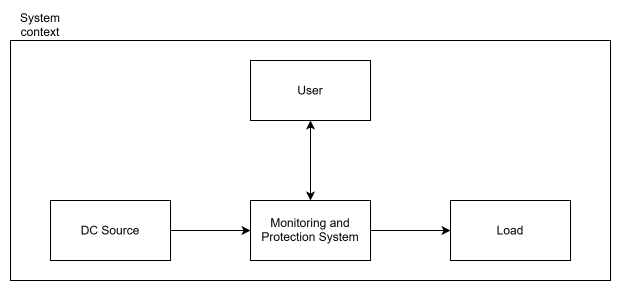
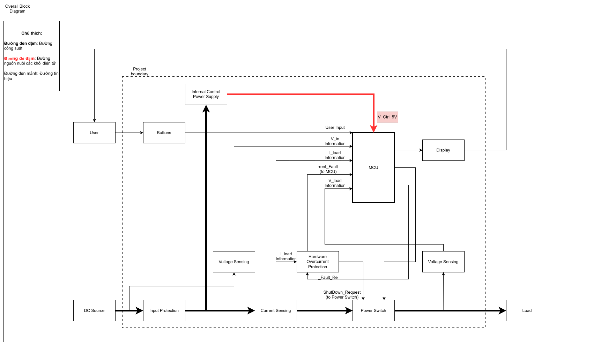
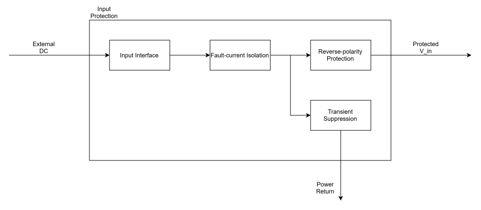
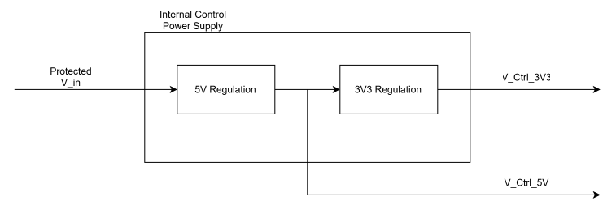
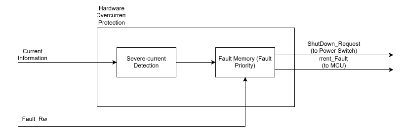
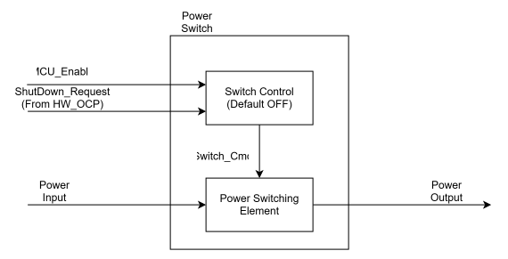
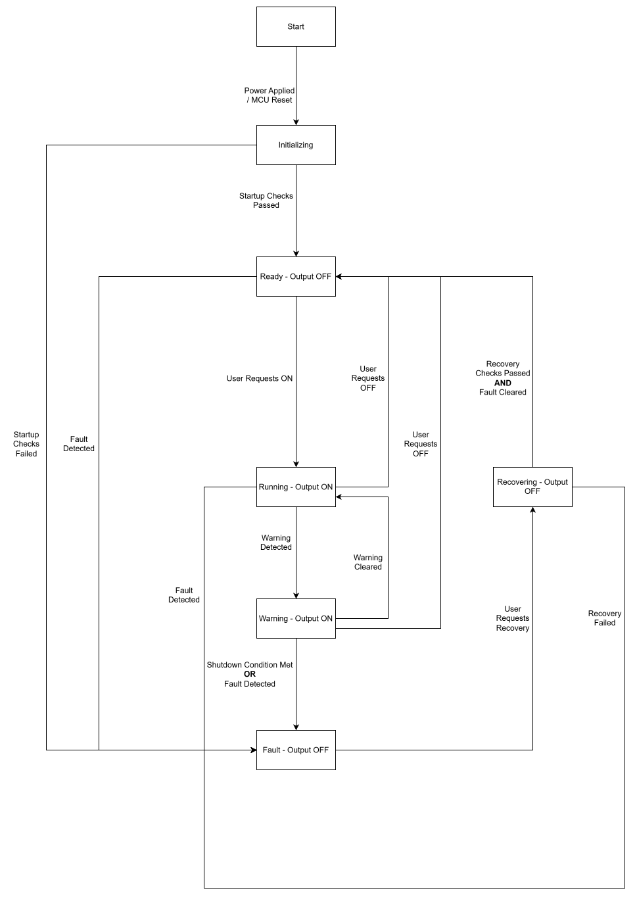

# Đặc tả thiết kế hệ thống

> Trạng thái: bản nháp kiến trúc chức năng v0.1, tổng hợp từ các sơ đồ của nhóm. Các thông số baseline trong Product Requirements vẫn giữ trạng thái tạm thời; tài liệu này chưa chốt linh kiện hoặc cách hiện thực phần cứng.

## 1. Phạm vi và biên hệ thống

Thiết bị nằm giữa nguồn DC ngoài và tải DC ngoài, giám sát đường công suất và có khả năng ngắt tải. Nguồn, tải và người dùng nằm ngoài biên hệ thống. Thiết bị không điều chỉnh điện áp công suất đầu ra thành một giá trị cố định.

Yêu cầu sản phẩm được mô tả tại [Product Requirements](product-requirements.md). Bản vẽ có thể chỉnh sửa nằm trong [system-architecture.drawio](diagrams/system-architecture.drawio); mỗi page tương ứng với một SVG được nhúng trong tài liệu này.

## 2. Kiến trúc tổng thể

Đường công suất đi qua Input Protection, Current Sensing và Power Switch trước khi đến tải. Nguồn điều khiển lấy từ nút sau Input Protection và trước Power Switch, nên việc ngắt tải không chủ động ngắt nguồn điều khiển. Nếu nguồn DC ngoài mất hoặc sụt dưới khả năng vận hành của nguồn nội bộ, hệ thống vẫn có thể mất nguồn.

Sơ đồ phân biệt đường công suất, đường nguồn nuôi điện tử và đường tín hiệu. Các đường cấp nguồn tới từng khối được lược bỏ để dễ đọc; việc phân phối rail cụ thể được xác định trong Hardware Specification.

Hai nút đo điện áp được định nghĩa trong kiến trúc hiện tại:

- `V_in`: sau Input Protection, trước Current Sensing và Power Switch.
- `V_load`: đầu ra hệ thống sau Power Switch, đo so với Power Return chung.

Khi đường công suất ON, `V_drop = V_in − V_load` phản ánh sụt áp giữa hai nút này. Khi switch OFF hoặc điện áp đang chuyển tiếp, không dùng hiệu điện áp đó để kết luận về tổn hao đường dẫn như khi hoạt động ổn định.

## 3. Các khối chức năng

### 3.1. Input Protection

Khối tiếp nhận nguồn ngoài, cô lập dòng sự cố, bảo vệ ngược cực và hạn chế xung điện áp. Đầu ra là `Protected V_in`, chưa phải điện áp được ổn áp. Transient Suppression là nhánh song song về Power Return. Thứ tự và topology linh kiện cụ thể, mức kẹp xung, giới hạn năng lượng và phương thức cô lập dòng được xác định khi thiết kế phần cứng.

Khối này bảo vệ đầu vào chung trước điểm chia nhánh. Nguyên tắc chức năng tạm chốt là xử lý điện áp nguy hiểm từ nguồn ngoài trong miền sự cố được công bố, phối hợp với khả năng chịu áp của phần phía sau, không phụ thuộc firmware. Chưa chốt thêm mạch ngắt/giới hạn áp cụ thể. Bảo vệ quá dòng tải bằng phần cứng thuộc Hardware Overcurrent Protection, còn quản lý quá tải theo profile thuộc firmware.

### 3.2. Internal Control Power Supply

Khối nhận `Protected V_in`, tạo rail 5 V và từ đó tạo rail 3.3 V để cấp cho các khối điện tử. Sơ đồ mô tả chức năng regulation, chưa khóa công nghệ converter. Cách hiện thực phải xét điện áp thực tế sau tổn hao Input Protection trên toàn miền nguồn ngoài 5–15 V.

Hai interface nguồn là `V_CTRL_5V` và `V_CTRL_3V3`. Rail nào cấp cho MCU/module, display, sensing và protection còn phụ thuộc phần cứng được chọn. Tụ và bộ lọc cục bộ cần cho regulator thuộc thiết kế chi tiết của khối.

### 3.3. Current Sensing

Khối quan sát dòng `I_load` trên đường cấp tải và cung cấp thông tin dòng tới MCU và Hardware Overcurrent Protection. Đây là một output thông tin chức năng có hai consumer; chưa khẳng định số tín hiệu vật lý, định dạng analog/digital hoặc công nghệ cảm biến.

Khối cung cấp thông tin, không quyết định ngắt switch. Interface dành cho bảo vệ phải cho phép xử lý độc lập với firmware và đáp ứng yêu cầu phản ứng của đường bảo vệ. Không cần diagram con ở mức kiến trúc hiện tại.

### 3.4. Voltage Sensing

Hai kênh quan sát `V_in` và `V_load` cung cấp thông tin riêng tới MCU. Chúng lấy mẫu điện áp tại hai nút, không mắc nối tiếp để mang toàn bộ dòng tải. Phương pháp đo, scaling, filtering và loại interface được xác định trong Hardware Specification. Không cần diagram con cho hai kênh này.

### 3.5. Hardware Overcurrent Protection

Khối phát hiện quá dòng nghiêm trọng từ Current Information mà không chờ firmware. Fault Memory giữ trạng thái lỗi, phát yêu cầu shutdown tới Power Switch và báo trạng thái trực tiếp cho MCU.

Fault Priority nghĩa là khi điều kiện phát hiện lỗi và yêu cầu clear đồng thời tồn tại, trạng thái lỗi được giữ. Việc xóa lỗi chỉ giải phóng yêu cầu shutdown; không tự tạo yêu cầu enable tải.

Ngưỡng phát hiện, độ trễ, trạng thái latch khi mất nguồn và cơ chế khởi tạo lại được xác định ở đặc tả thành phần. Không giả định Fault Memory giữ dữ liệu sau khi mất nguồn.

### 3.6. Power Switch

Switch Control tiếp nhận yêu cầu enable từ MCU và yêu cầu shutdown từ bảo vệ phần cứng. Shutdown có quyền ưu tiên; Power Switching Element thực hiện đóng/ngắt công suất theo kết quả phân xử.

Yêu cầu fail-safe là mặc định OFF khi MCU reset, mất nguồn điều khiển hoặc chưa có yêu cầu enable hợp lệ. Cơ chế điện bảo đảm hành vi này sẽ được xác định trong Hardware Specification. Loại phần tử đóng/ngắt, dòng rò khi OFF, khả năng chặn dòng ngược và tổn hao khi ON chưa được chốt tại đây.

### 3.7. MCU và giao diện người dùng

MCU nhận thông tin đo, trạng thái lỗi phần cứng và thao tác người dùng. Firmware giám sát miền vận hành theo cấu hình/profile, quản lý trạng thái và phục hồi, phát yêu cầu enable/clear và cập nhật display. Firmware không thay thế đường bảo vệ quá dòng nghiêm trọng bằng phần cứng.

Buttons nhận thao tác chọn profile, điều khiển đầu ra và yêu cầu phục hồi. Display hiển thị `V_in`, `V_load`, `I_load`, trạng thái và nguyên nhân lỗi. UART phục vụ debug, kiểm thử và logging, không bắt buộc cho vận hành thông thường; buzzer không bắt buộc trong v0.1.

Không cần diagram con cho MCU, Buttons hoặc Display tại bước này. Trạng thái và hành vi cấp hệ thống nằm tại mục 6; phân rã firmware, cách hiện thực state machine và luồng UI được mô tả trong Software Specification.

## 4. Interface chức năng

Tên chuẩn trong bảng dưới đây dùng để mô tả interface; các nhãn khác kiểu chữ trong bản vẽ hiện có được hiểu theo cùng ý nghĩa. Tên không quy định mức logic, cực tính hoặc chân linh kiện.

| Interface | Khối gửi | Khối nhận | Ý nghĩa |
| --- | --- | --- | --- |
| `V_IN_INFORMATION` | V_in Sensing | MCU | Thông tin điện áp đầu vào nội bộ |
| `V_LOAD_INFORMATION` | V_load Sensing | MCU | Thông tin điện áp đầu ra |
| `CURRENT_INFORMATION` | Current Sensing | MCU, HW Overcurrent Protection | Thông tin dòng tải; trong sơ đồ tổng thể ghi I_load Information |
| `MCU_ENABLE` | MCU | Power Switch | Yêu cầu đóng đường công suất |
| `SHUTDOWN_REQUEST` | HW Overcurrent Protection | Power Switch | Yêu cầu ngắt bắt buộc, ưu tiên hơn enable |
| `OVERCURRENT_FAULT_STATUS` | HW Overcurrent Protection | MCU | Trạng thái lỗi đã được giữ |
| `CLEAR_FAULT_REQUEST` | MCU | HW Overcurrent Protection | Yêu cầu xóa trạng thái lỗi |
| User Input | Buttons | MCU | Thao tác của người dùng |
| Display Information | MCU | Display | Giá trị đo, trạng thái và cảnh báo |
| `V_CTRL_5V`, `V_CTRL_3V3` | Internal Control Power Supply | Các khối cần nguồn | Rail nguồn điện tử; phân phối cụ thể TBD |

## 5. Các tình huống bất thường về điện

### 5.1. Hiện tượng, nguyên nhân và ảnh hưởng

Bảng dưới phân tích các hiện tượng có thể xảy ra trên nguồn, đường dẫn và tải. Việc liệt kê một hiện tượng không đồng nghĩa sản phẩm đã cam kết phát hiện hoặc bảo vệ được hiện tượng đó. Phạm vi xử lý được phân biệt riêng tại mục 5.2.

| Hiện tượng | Nguyên nhân có thể xảy ra | Biểu hiện và ảnh hưởng |
| --- | --- | --- |
| Điện áp nguồn quá cao, kéo dài | Cắm sai adapter, đặt sai điện áp nguồn điều chỉnh hoặc bộ nguồn bị lỗi | Điện áp đầu vào tăng, có thể truyền tới tải và gây quá áp cho nguồn nội bộ nếu không được hạn chế hoặc ngắt phù hợp |
| Điện áp nguồn quá thấp hoặc mất nguồn | Nguồn không đủ công suất, nguồn tự giới hạn dòng, dây cấp sụt áp hoặc nguồn bị ngắt | V_in giảm; V_load có thể giảm theo; nguồn điều khiển có thể mất ổn định hoặc mất hoàn toàn |
| Xung điện áp đầu vào | Dao động giữa điện cảm dây và tụ khi cắm nguồn, đóng/ngắt dòng hoặc nhiễu từ nguồn | Điện áp biến đổi nhanh; có thể vượt khả năng chịu đựng của linh kiện trước khi firmware phản ứng |
| Đấu ngược cực nguồn | Đấu nhầm cực dương và cực âm | Điện áp ngược xuất hiện tại đầu vào ngoài, có thể gây hỏng linh kiện hoặc dòng sự cố nếu không được chặn |
| Quá tải ở tải | Tải tiêu thụ vượt cấu hình cho phép; tải cơ tăng hoặc motor bị kẹt, tùy loại | I_load tăng, tổn hao và nhiệt tăng; nguồn có thể sụt áp |
| Ngắn mạch nhánh tải | Chập dây, đầu ra hoặc bên trong tải | I_load có thể tăng rất lớn, V_load thấp; nếu nguồn giới hạn dòng hoặc tự ngắt thì V_in cũng có thể sụt và dòng đo được có thể không đạt ngưỡng HW_OCP |
| Dòng khởi động hoặc đỉnh dòng trong vận hành | Nạp tụ đầu vào, khởi động motor hoặc tải đổi chế độ hoạt động | Dòng tăng tạm thời; có thể là hành vi hợp lệ theo profile hoặc vượt giới hạn hệ thống |
| Sụt áp quá lớn trên đường dẫn | Dòng lớn hoặc điện trở đường dẫn tăng do tiếp xúc kém, connector lỏng, phần tử công suất dẫn không tốt | V_drop tăng, tải thiếu áp; vị trí có điện trở lớn có thể phát nhiệt dù dòng chưa vượt giới hạn |
| Đường dẫn hở hoặc chập chờn | Đứt dây, mất tiếp xúc hoặc phần tử đóng/ngắt không dẫn như yêu cầu | Khi yêu cầu ON, tải có thể không nhận điện hoặc bị cấp điện gián đoạn; phép đo tại PCB không nhất thiết nhận biết mọi điểm hở ngoài PCB |
| Xung điện áp phía tải khi ngắt | Năng lượng trong điện cảm của tải hoặc dây cần đường thoát khi dòng bị ngắt | Điện áp tại nút liên quan có thể vượt miền cho phép hoặc đảo cực; bảo vệ xung đầu vào không mặc định bảo vệ được mọi nút phía tải |
| Điện áp còn lại hoặc cấp ngược từ phía tải | Tụ phía tải còn tích điện, tải có nguồn khác hoặc có khả năng trả năng lượng | V_load có thể còn khác 0 khi switch OFF; có thể xuất hiện dòng ngược nếu topology cho phép |
| Quá dòng/chập bên trong bo mạch | Lỗi lắp ráp, linh kiện hoặc rail nguồn điều khiển bị chập | Dòng đầu vào chung có thể tăng; Current Sensing đặt trên nhánh tải không quan sát trực tiếp dòng sự cố riêng của nhánh điều khiển |

Các hiện tượng trên có thể đi cùng nhau. Ngắn mạch là một nguyên nhân, quá dòng và sụt áp là những biểu hiện có thể phát sinh; chúng không phải các lỗi vật lý độc lập trong mọi trường hợp. Khi gần ổn định, V_drop xấp xỉ I_load nhân với điện trở đường dẫn, nên sụt áp lớn có thể do dòng tăng hoặc điện trở tăng.

Không kết luận nguyên nhân chỉ từ một phép đo: V_load thấp có thể do switch OFF bình thường, nguồn sụt, ngắn mạch hoặc đường dẫn hở. Phải xét vị trí đo, trạng thái switch, các đại lượng còn lại và cấu hình. Dòng khởi động/đỉnh dòng hợp lệ theo profile không mặc định là warning hoặc fault.

Tài liệu kỹ thuật tham khảo cho các nhóm hiện tượng: [TI — 11 Ways to Protect Your Power Path](https://www.ti.com/product-category/power-management/power-protection-switches-controllers/11-ways-to-protect-your-power-path.html) và [Analog Devices — Complete System Power Protection Design Guide](https://www.analog.com/en/resources/technical-articles/complete-system-power-protection-design-guide.html). Đây là tài liệu giải thích kỹ thuật, không phải danh sách chức năng sản phẩm đã được duyệt.

### 5.2. Phạm vi xử lý và phân chia trách nhiệm

Bảng này ghi nhận yêu cầu đã có, quyết định chức năng đã chốt và những cơ chế còn mở. Một chức năng có trong block diagram chưa đồng nghĩa khả năng bảo vệ đã được tính toán hoặc kiểm chứng. Không tự bổ sung chức năng bảo vệ ngoài phạm vi chỉ vì hiện tượng có trong mục 5.1.

| Tình huống | Phạm vi/trạng thái hiện tại | Phản ứng hoặc cơ chế | Khối chịu trách nhiệm và điểm còn mở |
| --- | --- | --- | --- |
| V_in gần giới hạn thấp/cao nhưng vẫn trong miền cho phép cấp điện | Warning V_in đã chốt ở mức chức năng | Khi đang ON, cảnh báo và tiếp tục cấp điện; hết cảnh báo thì xóa warning tương ứng. Không ngắt chỉ vì warning kéo dài nếu chưa đạt tiêu chí fault | MCU dựa trên V_in Sensing; miền cảnh báo, thời gian đánh giá và hysteresis TBD |
| V_in đạt tiêu chí quá thấp/quá cao của cấu hình | Fault V_in đã chốt ở mức chức năng | Giữ/ngắt đầu ra OFF, ghi nhận nguyên nhân và giữ FAULT; nguồn bình thường trở lại không tự xóa lỗi | MCU; ngưỡng và timing TBD. Chỉ áp dụng trong miền phần cứng và nguồn điều khiển còn có thể hoạt động; không thay thế bảo vệ quá áp gây hư hỏng |
| Dòng tải quá độ hợp lệ | Đã có trong FR-07 | Tiếp tục cấp điện trong miền dòng/thời gian được cấu hình cho phép; không trì hoãn bảo vệ quá dòng nghiêm trọng | MCU quản lý profile; giới hạn phần cứng và ngưỡng HW_OCP cần phối hợp |
| Quá tải nhánh tải do MCU giám sát | Warning/fault I_load đã chốt ở mức chức năng | Quá độ hợp lệ không tự là warning; đạt tiêu chí cảnh báo thì tiếp tục cấp điện, đạt tiêu chí ngắt quá tải thì yêu cầu OFF và giữ FAULT | MCU dựa trên Current Sensing; ngưỡng và thời gian cụ thể TBD; không trì hoãn HW_OCP |
| Quá dòng nghiêm trọng/ngắn mạch nhánh tải | Bảo vệ phần cứng độc lập firmware đã nằm trong phạm vi | HW_OCP phát hiện, giữ lỗi và cưỡng bức Power Switch OFF; báo trạng thái cho MCU | HW_OCP + Power Switch; ngưỡng, độ trễ và miền sự cố xử lý được TBD. Khi nguồn tự giới hạn dòng thấp, cần xét thêm thông tin điện áp và logic hệ thống; không bảo đảm HW_OCP luôn nhận diện ngắn mạch |
| Sụt áp đường công suất quá mức | Warning/fault V_drop khi ON đã chốt ở mức chức năng | Sau khi xét quá độ hợp lệ, đạt tiêu chí cảnh báo thì tiếp tục cấp điện; đạt tiêu chí ngắt thì yêu cầu OFF, ghi nhận sụt áp bất thường và giữ FAULT | MCU tính V_drop từ V_in và V_load, không cần cảm biến riêng; ngưỡng phải xét sai số đo, dòng tải, timing và vị trí đo. Các baseline sụt áp không tự là ngưỡng fault |
| Ngược cực và xung điện áp đầu vào | Có chức năng bảo vệ trong kiến trúc Input Protection | Chặn ngược cực; hạn chế xung bằng Transient Suppression với giới hạn được thiết kế | Input Protection; topology, mức điện áp còn lại và năng lượng chịu được TBD. Chưa chốt việc báo/latch sự kiện này về MCU; không mặc định mọi xung bị kẹp đều tạo FAULT |
| Quá áp đầu vào gây nguy hiểm cho phần cứng, đặc biệt kéo dài | Tạm chốt trách nhiệm tại bảo vệ đầu vào chung; cơ chế cụ thể TBD | Input Protection phối hợp với khả năng chịu áp của phần phía sau để xử lý trong miền sự cố công bố bằng hardware; không mặc định TVS chịu được quá áp kéo dài hoặc MCU ngắt tải sẽ bảo vệ được Internal Supply | Input Protection và Internal Supply; có cần ngắt/giới hạn áp chủ động hay không được đánh giá khi thiết kế, chưa bổ sung linh kiện hoặc subsystem mới |
| Dòng sự cố lớn trên phần đường nguồn chung được bảo vệ | Có chức năng Fault-current Isolation trong kiến trúc | Cô lập dòng sự cố; có thể làm mất nguồn cả điều khiển và tải | Input Protection; chưa chốt fuse/eFuse hay giải pháp khác, thời gian tác động và phối hợp chọn lọc với HW_OCP |
| Quá dòng/chập nhánh nguồn điều khiển | Khả năng bảo vệ cụ thể còn TBD | Đánh giá bảo vệ của Internal Supply và khả năng cô lập sự cố đầu vào; không coi HW_OCP tải là cơ chế bảo vệ trực tiếp nhánh này | Internal Supply/Input Protection; chưa chốt cơ chế hoặc cam kết duy trì MCU hoạt động trong sự cố này |
| V_load không phù hợp trạng thái OFF | Đã chốt hành vi chức năng theo FR-05; tiêu chí định lượng TBD | Cho phép điện áp dư hợp lệ theo đặc tính tải; chỉ khi đạt tiêu chí bất thường mới ghi nhận lỗi đầu ra, giữ yêu cầu OFF và vào FAULT | MCU, sensing và Power Switch; không yêu cầu chủ động xả tụ, không suy ra switch hỏng chỉ từ V_load, không bảo đảm cô lập được tải nếu switch hỏng ở trạng thái dẫn |
| Hở/chập chờn đường dẫn | Phân tích nguyên nhân, không cam kết chẩn đoán mọi điểm hở | Đối chiếu lệnh switch và thông tin đo; khi ON, sụt áp bất thường được đánh giá qua V_drop, chưa kết luận chính xác phần tử gây lỗi | MCU và sensing; giới hạn quan sát dây ngoài PCB, tiêu chí và chẩn đoán cụ thể TBD |
| Xung phía tải, dòng ngược và tải trả năng lượng | Tạm chốt trách nhiệm điện áp nguy hiểm phía tải tại thiết kế nhánh tải/Power Switch; phạm vi tải không đổi | Xét đường xử lý năng lượng, khả năng chịu xung và truyền ngược trong miền sự cố được công bố; không mặc định kẹp đầu vào bảo vệ mọi nút đầu ra hoặc OFF chặn được mọi dòng ngược | Cơ chế cụ thể TBD; chưa thêm subsystem hay linh kiện. Tải cảm mạnh hoặc trả năng lượng lớn vẫn ngoài phạm vi ban đầu; không mặc định mọi xung được xử lý đều tạo FAULT |

Hai vùng bảo vệ được phân chia theo vùng cấp nguồn và vị trí tác động, không theo quy tắc tách riêng dòng với áp. Input Protection nằm trước điểm chia nhánh; bảo vệ nhánh tải tác động lên Power Switch. Ngắt riêng tải không chủ động cắt Internal Supply, nhưng dòng sự cố tải vẫn có thể làm nguồn chung sụt và khiến MCU reset. Khả năng duy trì điều khiển cần được phân tích và thử nghiệm, không được suy ra chỉ từ việc có hai nhánh.

### 5.3. Nội dung tiếp tục đặc tả

Hành vi warning/fault và kiểm tra khởi động/phục hồi đã chốt ở mức chức năng được mô tả tại mục 6. Ngưỡng còn mở, timing, cách đo, thuật toán và phối hợp bảo vệ được cụ thể hóa trong Hardware/Software Specification; các phép thử và tiêu chí đạt được đưa vào Test Specification. Giới hạn chịu đựng phần cứng không được đồng nhất với giới hạn vận hành công bố. Các mục còn TBD trong bảng 5.2 chưa được coi là khả năng bảo vệ đã được hiện thực hoặc kiểm chứng.

## 6. Trạng thái và hành vi hệ thống

### 6.1. State diagram

**Ghi chú:** Đầu ra chỉ được phép ON trong RUNNING và WARNING. Xử lý lỗi phải ngắt có ưu tiên cao hơn các chuyển trạng thái khác. MCU reset từ bất kỳ trạng thái nào đều đưa hệ thống về INITIALIZING với yêu cầu đầu ra OFF.

`Start` là điểm bắt đầu, không phải trạng thái vận hành. Logic hiện tại gồm sáu trạng thái dưới đây, không có bước Enable Checks hoặc trạng thái Checking Before ON riêng. **Lưu ý đồng bộ bản vẽ:** nếu bản hình còn Checking Before ON thì trạng thái đó không còn áp dụng; bảng và mô tả dưới đây xác định logic hiện hành. Các file diagram được đồng bộ riêng.

ON/OFF trong tên trạng thái và bảng dưới mô tả yêu cầu điều khiển đường công suất. OFF không đồng nghĩa V_load lập tức bằng 0 hoặc xác nhận switch đã ngắt vật lý thành công. Nếu switch hỏng ở trạng thái dẫn, giữ yêu cầu OFF không bảo đảm cô lập được tải; hệ thống ghi nhận bất thường theo tiêu chí giám sát, chưa chốt cơ chế cô lập bổ sung. HW_OCP có thể ngắt trước khi MCU cập nhật trạng thái.

| Trạng thái | Yêu cầu đầu ra | Ý nghĩa |
| --- | --- | --- |
| INITIALIZING | OFF | Khởi tạo và kiểm tra ban đầu sau cấp nguồn/reset |
| READY | OFF | Các điều kiện cho phép bật đang đạt, không có lỗi đang giữ; chờ yêu cầu ON |
| RUNNING | ON | Cấp điện và giám sát tải bình thường |
| WARNING | ON | Còn ít nhất một cảnh báo nhưng chưa có lỗi phải ngắt |
| FAULT | OFF | Giữ lỗi và chờ yêu cầu phục hồi thủ công |
| RECOVERING | OFF | Kiểm tra phục hồi và xử lý xóa lỗi |

### 6.2. Điều kiện chuyển trạng thái

| Từ | Điều kiện/sự kiện | Đến |
| --- | --- | --- |
| Điểm bắt đầu hoặc bất kỳ trạng thái nào | Cấp nguồn/MCU reset | INITIALIZING |
| INITIALIZING | Kiểm tra khởi động đạt | READY |
| INITIALIZING | Kiểm tra khởi động thất bại | FAULT |
| READY | Người dùng yêu cầu ON, không đồng thời có lỗi phải ngắt | RUNNING |
| READY | Phát hiện lỗi | FAULT |
| RUNNING | Phát hiện cảnh báo | WARNING |
| RUNNING | Phát hiện lỗi phải ngắt | FAULT |
| WARNING | Không còn bất kỳ cảnh báo nào và không có lỗi phải ngắt | RUNNING |
| WARNING | Đạt điều kiện phải ngắt hoặc phát hiện lỗi | FAULT |
| RUNNING hoặc WARNING | Người dùng yêu cầu OFF, không đồng thời có lỗi phải giữ | READY |
| FAULT | Người dùng yêu cầu phục hồi | RECOVERING |
| RECOVERING | Kiểm tra phục hồi đạt và lỗi đã được xóa thành công | READY |
| RECOVERING | Kiểm tra hoặc xóa lỗi thất bại | FAULT |

Nếu không có điều kiện chuyển hợp lệ, hệ thống giữ trạng thái hiện tại. INITIALIZING chưa đủ thông tin để kết luận thì tiếp tục chờ với đầu ra OFF; giới hạn thời gian chờ cụ thể TBD.

Label `Warning Cleared` trên diagram được hiểu là không còn bất kỳ warning nào đang áp dụng, không phải chỉ một warning vừa hết. `Shutdown Condition Met` là đạt tiêu chí ngắt bảo vệ, không bao gồm lệnh OFF bình thường của người dùng. Cảnh báo kéo dài chỉ dẫn tới ngắt khi đạt tiêu chí tương ứng với loại lỗi/profile; không mặc định mọi cảnh báo có chung một timeout.

### 6.3. Giám sát, khởi động và yêu cầu ON/OFF

Khi nguồn điều khiển còn hoạt động, hệ thống tiếp tục giám sát V_in, V_load, I_load và trạng thái bảo vệ dù Power Switch ON hay OFF, đồng thời cung cấp trạng thái trên giao diện. Giám sát liên tục được hiểu là cập nhật định kỳ trong vận hành; chu kỳ cụ thể được đặc tả sau. Việc diễn giải thông tin đo phụ thuộc trạng thái switch.

Startup Checks xác nhận bốn điều kiện chức năng:

| Điều kiện | Ý nghĩa |
| --- | --- |
| Thông tin giám sát sẵn sàng và hợp lệ | Có thể sử dụng thông tin đo và trạng thái bảo vệ để đánh giá hệ thống |
| Cấu hình vận hành hợp lệ | Cấu hình nguồn/profile sử dụng được và không vượt giới hạn sản phẩm |
| V_in phù hợp cấu hình | Điện áp hiện tại nằm trong miền cho phép cấp điện của cấu hình |
| Không có lỗi ngăn cấp điện | Không có điều kiện lỗi hoặc lỗi đang giữ, bao gồm lỗi HW_OCP, ngăn vào READY |

Thông tin đo hợp lệ không đồng nghĩa giá trị đo nằm trong miền bình thường: một phép đo hoạt động đúng vẫn có thể báo V_in quá thấp. Chưa đủ thông tin thì giữ INITIALIZING; tất cả điều kiện đạt thì vào READY; xác định lỗi hoặc khởi tạo thất bại thì vào FAULT và hiển thị nguyên nhân trong khả năng giao diện còn hoạt động. Thời gian chờ và cách xác định tính hợp lệ TBD. Khi OFF, V_load thấp và I_load gần 0 không tự là lỗi, cũng không chứng minh tải không ngắn mạch.

READY được duy trì bằng giám sát liên tục. Khi nhận ON trong READY, MCU phát MCU_ENABLE và chuyển RUNNING; không khởi tạo hay thực hiện một bước Enable Checks riêng. Nếu đồng thời phát hiện lỗi thì ưu tiên giữ OFF và vào FAULT. Người dùng không phải giữ nút ON để duy trì cấp điện. READY chỉ xác nhận điều kiện cho phép thử cấp điện, chưa chứng minh tải không có sự cố; HW_OCP vẫn phải sẵn sàng khi bật. Quá độ hợp lệ của profile không được trì hoãn bảo vệ quá dòng nghiêm trọng.

Lệnh OFF của người dùng ngắt tải bình thường, không tự phát sinh FAULT và không xóa lỗi đang giữ. Các lỗi vận hành do firmware phát hiện và sự kiện HW_OCP đều đưa hệ thống về yêu cầu OFF + FAULT. Với HW_OCP, switch ngắt độc lập trước khi MCU tiếp nhận trạng thái và cập nhật giao diện. Không mặc định mọi sự kiện được xử lý bởi phần tử bảo vệ đầu vào đều được quan sát và latch thành FAULT trong MCU.

### 6.4. Warning, fault và tổng hợp nhiều nguyên nhân

- **Warning condition:** điều kiện cần thông báo và theo dõi nhưng chưa bắt buộc ngắt; khi đang cấp điện, hệ thống tiếp tục yêu cầu ON trong WARNING.
- **Fault condition:** điều kiện ngăn cấp điện hoặc yêu cầu ngắt nếu đang ON; nguyên nhân được ghi nhận và hệ thống giữ FAULT đến khi phục hồi hợp lệ. Điều kiện gây lỗi có thể đã hết nhưng trạng thái lỗi đã lưu vẫn còn.
- **Shutdown condition:** tiêu chí ngắt bảo vệ. Khi cảnh báo đạt tiêu chí này thì xác lập fault; fault nghiêm trọng có thể xuất hiện trực tiếp, không cần đi qua WARNING.

| Nhóm điều kiện | Warning | Fault hoặc phản ứng khác |
| --- | --- | --- |
| V_in | Gần giới hạn thấp/cao nhưng vẫn trong miền cho phép cấp điện | Đạt tiêu chí thấp áp/quá áp thì giữ/yêu cầu OFF và FAULT; áp trở lại bình thường không tự xóa lỗi |
| I_load do MCU đánh giá | Đạt tiêu chí cảnh báo quá tải, chưa đạt tiêu chí ngắt | Đạt tiêu chí ngắt của cấu hình/profile thì yêu cầu OFF và giữ FAULT; dòng về 0 sau ngắt không tự xóa lỗi. Quá độ hợp lệ không tự là warning |
| V_drop khi ON | Sụt áp đạt tiêu chí cảnh báo sau khi xét quá độ hợp lệ | Đạt tiêu chí ngắt thì yêu cầu OFF và giữ FAULT; báo sụt áp bất thường, không tự khẳng định phần tử gây lỗi |
| V_load khi OFF | Điện áp dư hợp lệ được theo dõi/hiển thị, không tự chuyển sang WARNING vốn là trạng thái cho phép ON | Đạt tiêu chí đầu ra không phù hợp OFF thì ghi nhận lỗi, giữ yêu cầu OFF và vào FAULT; chỉ còn điện chưa đủ chứng minh lỗi |
| Quá dòng nghiêm trọng | Không cần có warning trước | HW_OCP ngắt và giữ lỗi độc lập firmware, báo trạng thái để MCU ghi nhận FAULT |

V_drop được tính từ V_in − V_load, không cần thêm cảm biến. Chỉ đánh giá sụt áp đường dẫn khi ON, thông tin đo và đầu vào hợp lệ, đã xét quá độ cho phép. V_in và V_load cùng thấp nhưng chênh lệch nhỏ được xem xét qua điều kiện nguồn; V_in bình thường nhưng V_load thấp đáng kể được đánh giá qua V_drop. Không tạo thêm một lỗi thấp V_load trùng ý nghĩa với sụt áp này. Các baseline hiệu năng 0,2 V tại 1 A và 0,4 V tại 2 A không tự là ngưỡng warning/fault; ngưỡng chẩn đoán còn xét sai số hai kênh đo, dòng và timing.

Khi OFF, cho phép V_load giảm theo đặc tính xả của tải; không bắt buộc bằng 0 tức thời và chưa yêu cầu mạch chủ động xả tụ. Tiêu chí bất thường phải xét điện áp, thời gian và đặc tính tải; không suy ra chính xác switch hỏng, dòng rò hay nguồn cấp ngược chỉ từ V_load. Những khả năng ngoài giới hạn đo/miền bảo vệ phần cứng vẫn giữ phạm vi và TBD tại mục 5.2.

Lỗi phải ngắt và lỗi đang giữ chưa được phục hồi ưu tiên hơn warning hoặc lệnh ON. Khi không có fault và đang cấp điện, còn ít nhất một warning thì giữ WARNING; chỉ khi không còn warning nào mới về RUNNING. Ghi nhận và xóa từng nguyên nhân riêng: hết warning V_in không xóa warning V_drop còn tồn tại. Lệnh OFF vẫn được chấp nhận khi WARNING, nhưng không xóa lỗi đang giữ; nếu đồng thời có lỗi phải ngắt thì vào FAULT.

### 6.5. Phục hồi và bật lại

Không tự động retry. Chỉ khi người dùng yêu cầu phục hồi, hệ thống mới vào RECOVERING và vẫn giữ MCU_ENABLE không hoạt động.

Recovery Checks gồm:

1. **Điều kiện chung:** thông tin giám sát sẵn sàng/hợp lệ, cấu hình hợp lệ và V_in trong miền cho phép.
2. **Điều kiện theo nguyên nhân:** lỗi kiểm tra được khi OFF đã hết và không có lỗi khác ngăn phục hồi. Điều kiện kiểm tra phụ thuộc nguyên nhân, không chỉ phụ thuộc khối phát hiện.
3. **Xóa và xác nhận tại nơi giữ lỗi:** firmware hoặc Fault Memory của HW_OCP, theo bảng dưới.

| Lỗi đã ghi nhận | Kiểm tra và xử lý phục hồi |
| --- | --- |
| Lỗi do MCU | Kiểm tra theo nguyên nhân; khi hợp lệ, xóa lỗi firmware. Không bắt buộc gửi clear tới HW_OCP nếu khối đó không giữ lỗi |
| Lỗi HW_OCP | Sau khi điều kiện phục hồi đạt, tiếp tục giữ MCU_ENABLE không hoạt động, gửi CLEAR_FAULT_REQUEST và xác nhận OVERCURRENT_FAULT_STATUS không còn báo lỗi; xử lý ghi nhận lỗi tương ứng trong MCU |
| Nhiều lỗi đồng thời | Chỉ về READY khi mọi lỗi ngăn phục hồi đã được xử lý; xóa một nguyên nhân không tự xóa các nguyên nhân khác |

Không yêu cầu trạng thái lỗi đã lưu phải bằng 0 trước khi gửi clear: cần phân biệt điều kiện gây lỗi với trạng thái Fault Memory đang giữ. Fault Priority vẫn áp dụng nếu điều kiện phát hiện lỗi và clear đồng thời tồn tại.

Kiểm tra hoặc xóa lỗi thất bại thì về FAULT, giữ yêu cầu OFF và hiển thị lý do. Chỉ khi kiểm tra phục hồi đạt và lỗi đã được xóa thành công mới về READY; đầu ra vẫn OFF, người dùng phải gửi ON riêng. Khả năng READY được duy trì bằng giám sát hiện tại, không phải một giấy phép bật có hiệu lực bất kể điều kiện thay đổi.

Với lỗi V_in, có thể kiểm tra nguồn đã trở lại miền cho phép khi OFF. Với quá tải/ngắn mạch, I_load gần 0 sau ngắt không chứng minh tải đã hết sự cố; người dùng cần xử lý nguyên nhân trước khi yêu cầu phục hồi. Clear HW_OCP thành công chỉ xác nhận khóa lỗi đã được giải phóng. Nếu sự cố tái xuất hiện khi ON, các đường bảo vệ phải tiếp tục tác động. Tiêu chí theo từng lỗi, thời gian chờ và cách xác nhận cụ thể vẫn TBD; không giả định có thể kiểm tra mọi lỗi chỉ bằng phép đo khi OFF.

## 7. Các điểm cần hoàn thiện

- Sơ đồ tổng thể ghi `V_Ctrl_5V → MCU`: cần xác định khối MCU là module nhận 5 V hay chip dùng rail 3.3 V; chưa coi đây là quyết định cấp 5 V trực tiếp cho chip.
- Sửa lỗi chữ `Dectection` trong diagram bảo vệ và thống nhất tên tín hiệu giữa diagram tổng thể, diagram con và bảng interface.
- Chốt phần cứng, phương pháp sensing, dạng interface, mức logic, ngưỡng bảo vệ và timing ở đặc tả thành phần.
- Cụ thể hóa ngưỡng, timing, hysteresis, tính hợp lệ của thông tin đo và tiêu chí phục hồi theo từng lỗi trên nền hành vi đã chốt tại mục 6; không bổ sung lại bước Enable Checks riêng.
- Xác định hành vi chi tiết khi nguồn nội bộ mất/sụt và trạng thái latch sau mất nguồn; yêu cầu đầu ra mặc định OFF giữ nguyên.
- Chưa chốt việc bổ sung yêu cầu từ MCU để latch phần cứng giữ mọi lỗi firmware; không bổ sung interface này trong kiến trúc hiện tại.
- Đối chiếu vị trí đo V_in và các quyết định kiến trúc với Product Requirements trước khi chốt bản đặc tả để triển khai.

## 8. Quản lý bản vẽ

Chỉnh sửa trên file `.drawio`, sau đó xuất lại SVG của page tương ứng và đưa hai bản vào cùng thay đổi Git. SVG dùng để xem trên GitHub; `.drawio` là nguồn chỉnh sửa. Không cần xuất DOCX/PPTX vào repo.
