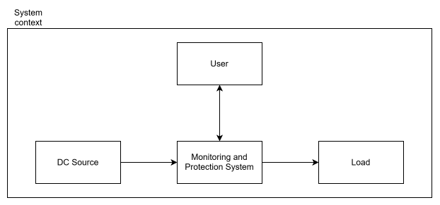
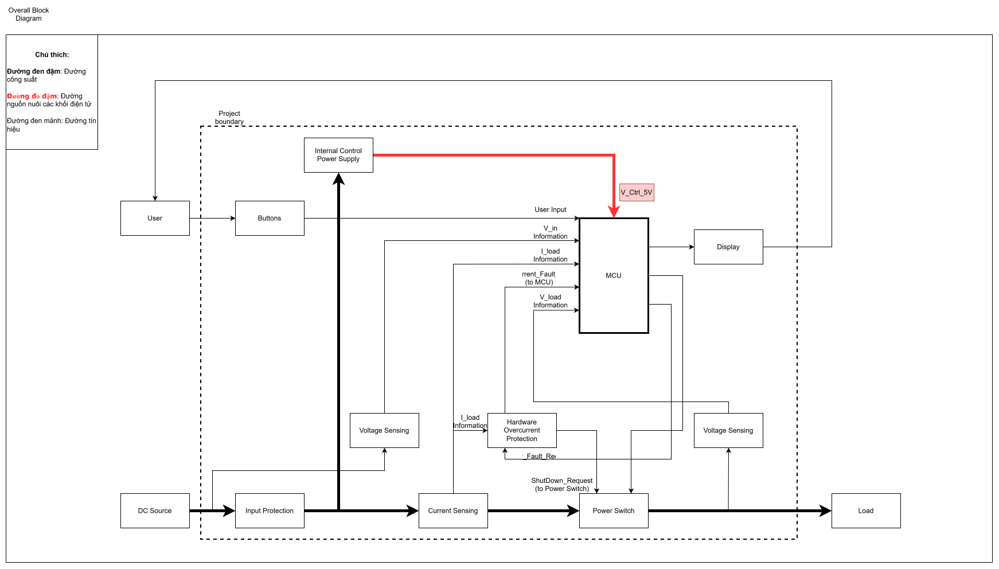
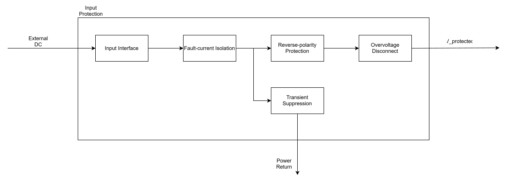
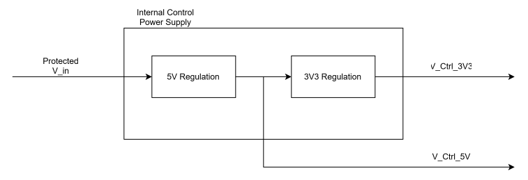
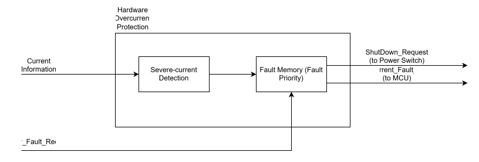
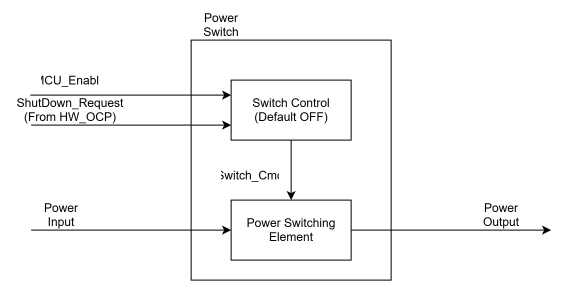
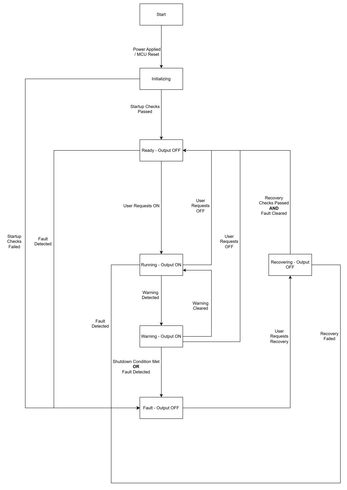

# Đặc tả thiết kế hệ thống

> Trạng thái: giữ kiến trúc chức năng v0.1 và các sơ đồ hiện tại; nội dung cấu hình, giám sát và bảo vệ được đồng bộ theo Product Requirements phiên bản 2. Miền điện áp 5–15 V đã được chọn; các chỉ tiêu hiệu năng còn lại là mục tiêu thiết kế, chưa phải kết quả kiểm chứng trên sản phẩm. Các chính sách khởi động, reset và phục hồi không bị thay thế chỉ vì Requirement v2 không nhắc lại.
>
> Cập nhật: 2026-11-05

## 1. Phạm vi và biên hệ thống

Thiết bị nằm giữa nguồn DC ngoài và tải DC ngoài, giám sát đường công suất và có khả năng ngắt tải. Nguồn, tải và người dùng nằm ngoài biên hệ thống. Thiết bị không điều chỉnh điện áp công suất đầu ra thành một giá trị cố định.

Yêu cầu sản phẩm được mô tả tại [Product Requirements](product-requirements.md). Bản vẽ có thể chỉnh sửa nằm trong [system-architecture.drawio](diagrams/system-architecture.drawio); mỗi page tương ứng với một SVG được nhúng trong tài liệu này.

## 2. Kiến trúc tổng thể

Đường công suất đi qua Input Protection, Current Sensing và Power Switch trước khi đến tải. Nguồn điều khiển lấy từ nút sau Input Protection và trước Power Switch, nên việc ngắt tải không chủ động ngắt nguồn điều khiển. Nếu nguồn DC ngoài mất hoặc sụt dưới khả năng vận hành của nguồn nội bộ, hệ thống vẫn có thể mất nguồn.

Sơ đồ phân biệt đường công suất, đường nguồn nuôi điện tử và đường tín hiệu. Các đường cấp nguồn tới từng khối được lược bỏ để dễ đọc; việc phân phối rail cụ thể được xác định trong Hardware Specification.

Hai nút đo điện áp được định nghĩa trong kiến trúc hiện tại:

- `V_in`: tại đầu nối nguồn vào của PCB, trước Input Protection.
- `V_load`: tại đầu nối tải ra của PCB, sau Power Switch.

Hai điện áp được xác định so với Power Return chung; vị trí lấy mẫu và đường hồi đo cụ thể phải phù hợp với phép đo giữa các đầu nối và được xác định trong Hardware Specification.

`V_protected` là điện áp tại đầu ra Input Protection, trước điểm chia sang nguồn điều khiển và nhánh tải; tương ứng với nhãn `Protected V_in` trong diagram con. Đây không phải `V_in` và chưa yêu cầu thêm kênh đo riêng cho nút này.

Khi đường công suất ON và đã xét quá độ hợp lệ, `V_drop = V_in − V_load` phản ánh sụt áp toàn đường công suất giữa hai đầu nối PCB, bao gồm Input Protection, Current Sensing, Power Switch và các phần dẫn nối tiếp. Không bao gồm dây bên ngoài PCB. Khi switch OFF hoặc điện áp đang chuyển tiếp, không dùng hiệu điện áp đó để kết luận về tổn hao đường dẫn như khi hoạt động ổn định.

Miền nguồn ngoài 5–15 V được áp dụng tại `V_in`, không phải `V_protected`. Ngưỡng warning/fault của `V_in` phải xét cấu hình, sai số đo, timing và hysteresis; các giá trị cụ thể vẫn TBD, không tự chốt ngưỡng ngắt đúng tại hai biên chỉ từ miền vận hành công bố.

## 3. Các khối chức năng

### 3.1. Input Protection

Khối tiếp nhận nguồn ngoài, cô lập dòng sự cố, bảo vệ ngược cực, hạn chế xung điện áp và ngắt nguồn chung khi quá áp đầu vào. Đầu ra là `V_protected` (`Protected V_in` trên diagram), chưa phải điện áp được ổn áp. Transient Suppression là nhánh song song về Power Return. Thứ tự và topology linh kiện cụ thể, mức kẹp xung, giới hạn năng lượng và phương thức cô lập dòng được xác định khi thiết kế phần cứng.

Khối này bảo vệ đầu vào chung trước điểm chia nhánh. Hành vi đã thống nhất là ngắt nguồn chung khi quá áp đầu vào kéo dài, nhằm bảo vệ cả nhánh điều khiển và nhánh tải, không phụ thuộc firmware. Phương án đã chọn cho chức năng Overvoltage Disconnect là IC controller bảo vệ nguồn chuyên dụng kết hợp MOSFET ngoài. Model IC, loại/số lượng MOSFET, topology, ngưỡng, thời gian tác động, miền sự cố và cách phục hồi còn phải được xác định và phối hợp với khả năng chịu áp của phần phía sau. Khả năng dùng chung cụm MOSFET cho chống ngược cực và ngắt quá áp sẽ được đánh giá khi chọn controller. Đây là bảo vệ nguồn chung, không đồng nhất với đánh giá V_in và ngắt riêng tải của MCU. Bảo vệ quá dòng tải bằng phần cứng thuộc Hardware Overcurrent Protection, còn đánh giá dòng cao theo các ngưỡng và thời gian cấu hình thuộc firmware.

Nhánh lấy mẫu `V_in` nằm trước khối này nên không được hưởng bảo vệ chung; bảo vệ đầu vào của nhánh đo thuộc Voltage Sensing tại mục 3.4.

### 3.2. Internal Control Power Supply

Khối nhận `V_protected` (`Protected V_in` trên diagram), tạo rail 5 V và từ đó tạo rail 3.3 V để cấp cho các khối điện tử. Sơ đồ mô tả chức năng regulation, chưa khóa công nghệ converter. Cách hiện thực phải xét điện áp thực tế sau tổn hao Input Protection trên toàn miền nguồn ngoài 5–15 V, kể cả khả năng duy trì rail khi `V_in = 5 V` và `V_protected` thấp hơn 5 V. Nguồn nuôi MCU vẫn lấy sau Input Protection, không chuyển theo điểm lấy mẫu `V_in`.

Hai interface nguồn là `V_CTRL_5V` và `V_CTRL_3V3`. Rail nào cấp cho MCU/module, display, sensing và protection còn phụ thuộc phần cứng được chọn. Tụ và bộ lọc cục bộ cần cho regulator thuộc thiết kế chi tiết của khối.

Nguyên tắc thiết kế đã thống nhất là dành phần tự tiêu thụ cho các khối điện tử trước khi phân bổ khả năng cấp dòng còn lại cho tải. Phần dự phòng được quy về đầu vào nguồn ngoài, không đồng nhất với dòng trên các rail nội bộ; giá trị phải xét miền V_in, chế độ hoạt động, hiệu suất chuyển đổi và dung sai. Chưa chốt mức dự phòng cụ thể và chưa yêu cầu thêm kênh đo dòng tổng. Ngưỡng và thời gian dòng cao phải phù hợp khả năng nguồn cũng như giới hạn vận hành ngắn hạn của thiết bị.

Theo PR-PWR-04, mục tiêu tự tiêu thụ ≤2 W được kiểm tra tại đầu nối nguồn vào khi không nối tải, thiết bị đã ổn định, ở cả trạng thái đầu ra ON và OFF trong miền 5–15 V. Điều kiện đo không tải này không thay thế việc tính và kiểm chứng dòng cấp nhánh điều khiển khi thiết bị đang mang tải.

### 3.3. Current Sensing

Khối quan sát dòng `I_load` trên đường cấp tải và cung cấp thông tin dòng tới MCU và Hardware Overcurrent Protection. Đây là một output thông tin chức năng có hai consumer; chưa khẳng định số tín hiệu vật lý, định dạng analog/digital hoặc công nghệ cảm biến.

Khối cung cấp thông tin, không quyết định ngắt switch. Interface dành cho bảo vệ phải cho phép xử lý độc lập với firmware và đáp ứng yêu cầu phản ứng của đường bảo vệ. Mục tiêu sai số đo I_load là ±0,05 A trong miền 0–2 A theo PR-PERF-06. Đường thông tin dành cho HW_OCP phải còn sử dụng được tại mục tiêu tác động 2,5 A của PR-PERF-09; không suy ra yêu cầu đo chính xác dòng ở mức này hoặc bắt buộc MCU thu được dòng đỉnh. Không cần diagram con ở mức kiến trúc hiện tại.

### 3.4. Voltage Sensing

Hai kênh quan sát `V_in` và `V_load` cung cấp thông tin riêng tới MCU. Chúng lấy mẫu điện áp tại hai nút, không mắc nối tiếp để mang toàn bộ dòng tải. Mục tiêu sai số toàn kênh là ±0,05 V cho V_in trong miền 5–15 V và V_load trong miền 0–15 V, theo PR-PERF-04 và PR-PERF-05. Sai số xác định V_drop = V_in − V_load không quá ±0,1 V khi đầu ra ON và các phép đo nằm trong miền quy định, theo PR-PERF-07. Phương pháp đo, scaling, filtering, sự phối hợp thời điểm lấy mẫu và loại interface được xác định trong Hardware Specification; không phân bổ sai số tùy ý cho từng linh kiện ở đây. Không cần diagram con cho hai kênh này.

Kênh đo `V_in` bao gồm bảo vệ đầu vào đo phù hợp vì lấy mẫu trước Input Protection. Thiết kế phải xét quá áp, xung điện áp, ngược cực và tình huống có điện áp đầu vào khi khối đo/MCU chưa được cấp nguồn; không để đường tín hiệu đo gây hỏng các khối phía sau trong miền sự cố được đặc tả. Bảo vệ đầu vào đo không được che mất khả năng đo/phát hiện điện áp trong miền yêu cầu, bao gồm khả năng nhận biết quá áp trên 15 V. Miền đo mở rộng, miền sự cố chịu được và cơ chế bảo vệ cụ thể còn TBD; phải đáp ứng các mục tiêu sai số đã nêu trong miền đo quy định. Chưa chốt linh kiện hay bắt buộc một phương pháp đo riêng.

Việc lấy mẫu trước Input Protection không bảo đảm MCU vẫn quan sát/hiển thị được khi bảo vệ đầu vào đã ngắt nguồn điều khiển. Đánh giá điện áp bằng firmware chỉ áp dụng khi nguồn điều khiển và thông tin đo còn hợp lệ.

### 3.5. Hardware Overcurrent Protection

Khối phát hiện quá dòng nghiêm trọng từ Current Information mà không chờ firmware. Fault Memory giữ trạng thái lỗi, phát yêu cầu shutdown tới Power Switch và báo trạng thái trực tiếp cho MCU.

Ngưỡng tác động thực tế của HW_OCP phải >2 A và ≤2,5 A theo PR-PERF-09. Khoảng này áp dụng cho toàn đường xác lập ngưỡng, có xét sai số Current Sensing, tham chiếu và comparator. Giá trị danh định, dung sai cụ thể và tiêu chí kiểm thử được xác định trong Hardware Design và kế hoạch kiểm thử. Giới hạn vận hành và khả năng chịu sự cố của phần cứng được quy định riêng; ngưỡng quá dòng phần mềm tiếp tục theo cấu hình người dùng.

Mục tiêu thời gian ngắt ≤100 µs theo PR-PERF-10 trong Product Requirements được tính cho toàn đường Current Sensing → HW_OCP → Power Switch: từ lúc dòng nhánh tải vượt ngưỡng HW_OCP đến khi Power Switch thực sự ngắt đường cấp điện từ nguồn tới tải. Phải tính cả độ trễ đo/phát hiện, giữ lỗi và điều khiển, cùng thời gian ngắt phần tử công suất; phát SHUTDOWN_REQUEST chưa phải mốc kết thúc. Dung sai ngưỡng, điều kiện thử và tiêu chí xác nhận ngắt được cụ thể hóa trong Hardware/Test Specification; không dùng V_load về 0 làm điều kiện kết thúc.

Fault Memory giữ kết quả phát hiện lỗi, không phải bộ lưu dạng sóng hoặc dữ liệu đo lúc sự cố. MCU biết HW_OCP đã tác động do quá dòng nghiêm trọng, nhưng không mặc định biết dòng đỉnh, điện áp tại thời điểm lỗi hay nguyên nhân vật lý cụ thể. Phép đo sau ngắt mô tả trạng thái sau ngắt, không thay thế dữ liệu lúc sự cố. Chưa yêu cầu cơ chế thu thập/lưu các dữ liệu đó.

Fault Priority nghĩa là khi điều kiện phát hiện lỗi và yêu cầu clear đồng thời tồn tại, trạng thái lỗi được giữ. Việc xóa lỗi chỉ giải phóng yêu cầu shutdown; không tự tạo yêu cầu enable tải.

Dung sai ngưỡng, độ trễ từng khâu, hành vi điện của latch khi cấp/mất nguồn và cơ chế khởi tạo lại được xác định ở đặc tả thành phần. MCU reset không tự gửi yêu cầu clear HW_OCP. Nếu latch còn giữ lỗi thì khởi động phải đọc lại và xử lý theo mục 6.3; không giả định Fault Memory giữ trạng thái sau mất nguồn hoàn toàn và chưa yêu cầu lưu lỗi bền vững.

### 3.6. Power Switch

Switch Control tiếp nhận yêu cầu enable từ MCU và yêu cầu shutdown từ bảo vệ phần cứng. Shutdown có quyền ưu tiên; Power Switching Element thực hiện đóng/ngắt công suất theo kết quả phân xử.

Yêu cầu fail-safe là mặc định OFF khi MCU reset, mất nguồn điều khiển hoặc chưa có yêu cầu enable hợp lệ. Cơ chế điện bảo đảm hành vi này sẽ được xác định trong Hardware Specification. Loại phần tử đóng/ngắt, dòng rò khi OFF, khả năng chặn dòng ngược và tổn hao khi ON chưa được chốt tại đây.

### 3.7. MCU và giao diện người dùng

MCU nhận thông tin đo, trạng thái lỗi phần cứng và thao tác người dùng. Firmware đánh giá V_in, I_load và V_drop theo các ngưỡng và thời gian đang áp dụng, quản lý trạng thái và phục hồi, phát yêu cầu enable/clear và cập nhật display. Dòng khởi động và dòng tăng cao trong vận hành dùng chung quy tắc mức dòng–thời gian tại mục 6.4. Firmware không thay thế đường bảo vệ quá dòng nghiêm trọng bằng phần cứng.

Buttons nhận thao tác thiết lập/chọn bộ cấu hình, chỉnh ngưỡng và thời gian cho phép, điều khiển đầu ra và yêu cầu phục hồi. Display hiển thị `V_in`, `V_load`, `I_load`, trạng thái, các cảnh báo đang có và nguyên nhân ngắt theo FR-06; chu kỳ cập nhật mục tiêu không quá 200 ms theo PR-PERF-08. Cách nhập từng tham số và bố trí giao diện được cụ thể hóa ở Software Specification. UART phục vụ debug, kiểm thử và logging, không bắt buộc cho vận hành thông thường; buzzer không bắt buộc trong baseline kiến trúc hiện tại.

Không cần diagram con cho MCU, Buttons hoặc Display tại bước này. Trạng thái và hành vi cấp hệ thống nằm tại mục 6; phân rã firmware, cách hiện thực state machine và luồng UI được mô tả trong Software Specification.

## 4. Interface chức năng

Tên chuẩn trong bảng dưới đây dùng để mô tả interface; các nhãn khác kiểu chữ trong bản vẽ hiện có được hiểu theo cùng ý nghĩa. Tên không quy định mức logic, cực tính hoặc chân linh kiện.

| Interface | Khối gửi | Khối nhận | Ý nghĩa |
| --- | --- | --- | --- |
| `V_IN_INFORMATION` | V_in Sensing | MCU | Thông tin điện áp tại đầu nối nguồn vào PCB, trước Input Protection |
| `V_LOAD_INFORMATION` | V_load Sensing | MCU | Thông tin điện áp đầu ra |
| `CURRENT_INFORMATION` | Current Sensing | MCU, HW Overcurrent Protection | Thông tin dòng tải; trong sơ đồ tổng thể ghi I_load Information |
| `MCU_ENABLE` | MCU | Power Switch | Yêu cầu đóng đường công suất |
| `SHUTDOWN_REQUEST` | HW Overcurrent Protection | Power Switch | Yêu cầu ngắt bắt buộc, ưu tiên hơn enable |
| `OVERCURRENT_FAULT_STATUS` | HW Overcurrent Protection | MCU | Trạng thái quá dòng nghiêm trọng đã được giữ; không kèm dữ liệu dòng/áp lúc sự cố |
| `CLEAR_FAULT_REQUEST` | MCU | HW Overcurrent Protection | Yêu cầu xóa trạng thái lỗi |
| User Input | Buttons | MCU | Thao tác của người dùng |
| Display Information | MCU | Display | Giá trị đo, trạng thái và cảnh báo |
| `V_CTRL_5V`, `V_CTRL_3V3` | Internal Control Power Supply | Các khối cần nguồn | Rail nguồn điện tử; phân phối cụ thể TBD |

## 5. Các tình huống bất thường về điện

### 5.1. Hiện tượng, nguyên nhân và ảnh hưởng

Bảng dưới phân tích các hiện tượng có thể xảy ra trên nguồn, đường dẫn và tải. Việc liệt kê một hiện tượng không đồng nghĩa sản phẩm đã cam kết phát hiện hoặc bảo vệ được hiện tượng đó. Phạm vi xử lý được phân biệt riêng tại mục 5.2.

| Hiện tượng | Nguyên nhân có thể xảy ra | Biểu hiện và ảnh hưởng |
| --- | --- | --- |
| Điện áp nguồn quá cao, kéo dài | Cắm sai adapter, đặt sai điện áp nguồn điều chỉnh hoặc bộ nguồn bị lỗi | Điện áp đầu vào tăng, có thể truyền tới tải và gây quá áp cho nguồn nội bộ nếu không được hạn chế hoặc ngắt phù hợp |
| Điện áp nguồn quá thấp hoặc mất nguồn | Nguồn không đủ công suất, nguồn tự giới hạn dòng, dây cấp sụt áp hoặc nguồn bị ngắt | V_in giảm; V_load có thể giảm theo; nguồn điều khiển có thể mất ổn định hoặc mất hoàn toàn |
| Xung điện áp đầu vào | Dao động giữa điện cảm dây và tụ khi cắm nguồn, đóng/ngắt dòng hoặc nhiễu từ nguồn | Điện áp biến đổi nhanh; có thể vượt khả năng chịu đựng của linh kiện trước khi firmware phản ứng |
| Đấu ngược cực nguồn | Đấu nhầm cực dương và cực âm | Điện áp ngược xuất hiện tại đầu vào ngoài, có thể gây hỏng linh kiện hoặc dòng sự cố nếu không được chặn |
| Quá tải ở tải | Tải tiêu thụ vượt cấu hình cho phép; tải cơ tăng hoặc motor bị kẹt, tùy loại | I_load tăng, tổn hao và nhiệt tăng; nguồn có thể sụt áp |
| Ngắn mạch nhánh tải | Chập dây, đầu ra hoặc bên trong tải | I_load có thể tăng rất lớn, V_load thấp; nếu nguồn giới hạn dòng hoặc tự ngắt thì V_in cũng có thể sụt và dòng đo được có thể không đạt ngưỡng HW_OCP |
| Dòng khởi động hoặc đỉnh dòng trong vận hành | Nạp tụ đầu vào, khởi động motor hoặc tải đổi chế độ hoạt động | Dòng tăng tạm thời; có thể là hành vi hợp lệ theo profile hoặc vượt giới hạn hệ thống |
| Sụt áp quá lớn trên đường dẫn | Dòng lớn hoặc điện trở đường dẫn tăng do tiếp xúc kém, connector lỏng, phần tử công suất dẫn không tốt | V_drop tăng, tải thiếu áp; vị trí có điện trở lớn có thể phát nhiệt dù dòng chưa vượt giới hạn |
| Đường dẫn hở hoặc chập chờn | Đứt dây, mất tiếp xúc hoặc phần tử đóng/ngắt không dẫn như yêu cầu | Khi yêu cầu ON, tải có thể không nhận điện hoặc bị cấp điện gián đoạn; phép đo tại PCB không nhất thiết nhận biết mọi điểm hở ngoài PCB |
| Xung điện áp phía tải khi ngắt | Năng lượng trong điện cảm của tải hoặc dây cần đường thoát khi dòng bị ngắt | Điện áp tại nút liên quan có thể vượt miền cho phép hoặc đảo cực; bảo vệ xung đầu vào không mặc định bảo vệ được mọi nút phía tải |
| Điện áp còn lại hoặc cấp ngược từ phía tải | Tụ phía tải còn tích điện, tải có nguồn khác hoặc có khả năng trả năng lượng | V_load có thể còn khác 0 khi switch OFF; có thể xuất hiện dòng ngược nếu topology cho phép |
| Quá dòng/chập bên trong bo mạch | Lỗi lắp ráp, linh kiện hoặc rail nguồn điều khiển bị chập | Dòng đầu vào chung có thể tăng; Current Sensing đặt trên nhánh tải không quan sát trực tiếp dòng sự cố riêng của nhánh điều khiển |

Các hiện tượng trên có thể đi cùng nhau. Ngắn mạch là một nguyên nhân, quá dòng và sụt áp là những biểu hiện có thể phát sinh; chúng không phải các lỗi vật lý độc lập trong mọi trường hợp. Sụt áp lớn có thể do dòng tăng hoặc điện trở đường dẫn tăng. V_drop bao gồm cả đoạn chung qua Input Protection mang dòng tải cộng dòng cấp nhánh điều khiển và đoạn riêng mang dòng tải; không mặc định toàn bộ V_drop bằng I_load nhân với một điện trở đường dẫn cố định. Quan hệ sụt áp cụ thể còn phụ thuộc phần tử bảo vệ được chọn.

Không kết luận nguyên nhân chỉ từ một phép đo: V_load thấp có thể do switch OFF bình thường, nguồn sụt, ngắn mạch hoặc đường dẫn hở. Phải xét vị trí đo, trạng thái switch, các đại lượng còn lại và cấu hình. Dòng khởi động và dòng tăng cao khi vận hành đều được đánh giá theo cùng các ngưỡng và thời gian cấu hình. Một đợt dòng cao còn được phép tiếp tục cấp điện vẫn có thể tạo warning nếu vượt ngưỡng cảnh báo; không coi tên loại tải hoặc giai đoạn khởi động là lý do miễn cảnh báo/ngắt.

Tài liệu kỹ thuật tham khảo cho các nhóm hiện tượng: [TI — 11 Ways to Protect Your Power Path](https://www.ti.com/product-category/power-management/power-protection-switches-controllers/11-ways-to-protect-your-power-path.html) và [Analog Devices — Complete System Power Protection Design Guide](https://www.analog.com/en/resources/technical-articles/complete-system-power-protection-design-guide.html). Đây là tài liệu giải thích kỹ thuật, không phải danh sách chức năng sản phẩm đã được duyệt.

### 5.2. Phạm vi xử lý và phân chia trách nhiệm

Bảng này xác định phạm vi, khối chịu trách nhiệm và giới hạn còn mở. Phản ứng warning/fault được quy định tập trung tại mục 6.4; phục hồi tại mục 6.5. Một chức năng có trong block diagram chưa đồng nghĩa khả năng bảo vệ đã được tính toán hoặc kiểm chứng; không tự bổ sung chức năng chỉ vì hiện tượng có trong mục 5.1.

| Tình huống | Phạm vi và khối chịu trách nhiệm | Giới hạn hoặc nội dung còn mở |
| --- | --- | --- |
| `V_in` gần hoặc vượt giới hạn cấu hình | Warning/fault ở mức chức năng do MCU đánh giá từ V_in Sensing, theo mục 6.4 | Ngưỡng, timing và hysteresis TBD. Chỉ áp dụng khi phần cứng, nguồn điều khiển và thông tin đo còn hợp lệ; không thay thế bảo vệ quá áp gây hư hỏng |
| Dòng tải tăng cao ngắn hạn | MCU đánh giá theo cấu hình, UC-03, FR-07 và mục 5.1 của Product Requirements v2 | Dùng chung quy tắc cho khởi động/runtime; có thể warning khi vẫn được phép cấp điện. Không vượt giới hạn sản phẩm hoặc trì hoãn HW_OCP |
| Quá tải nhánh tải | Warning/fault `I_load` do MCU đánh giá từ Current Sensing, theo mục 6.4 | Đạt ngưỡng ngắt hoặc hết thời gian dòng cao thì ngắt; độ trễ theo PR-PERF-11. Các giá trị cấu hình cụ thể còn TBD; không trì hoãn HW_OCP |
| Quá dòng nghiêm trọng/ngắn mạch nhánh tải | HW_OCP + Power Switch bảo vệ độc lập firmware, theo mục 3.5 và 3.6 | Ngưỡng tác động thực tế >2 A và ≤2,5 A theo PR-PERF-09; thời gian theo PR-PERF-10. Giá trị danh định, dung sai cụ thể và miền sự cố còn TBD. Nguồn tự giới hạn dòng có thể khiến dòng chưa đạt ngưỡng HW_OCP; phối hợp với các đường giám sát khác theo miền sự cố hỗ trợ |
| Sụt áp đường công suất quá mức | MCU tính `V_drop` từ `V_in` và `V_load`, không thêm cảm biến; hành vi tại mục 6.4 | Ngưỡng phải xét vị trí đo, sai số, dòng và timing; các baseline sụt áp không tự là ngưỡng fault |
| Ngược cực và xung điện áp đầu vào | Input Protection: bảo vệ ngược cực và Transient Suppression theo mục 3.1 | Topology, mức điện áp còn lại và năng lượng chịu được TBD. Kênh đo trước protection được bảo vệ riêng theo mục 3.4. Chưa chốt báo/latch sự kiện về MCU; không mặc định mọi xung bị kẹp đều tạo FAULT |
| Quá áp đầu vào gây nguy hiểm, đặc biệt kéo dài | Input Protection ngắt nguồn chung theo hành vi đã thống nhất tại mục 3.1, phối hợp khả năng chịu áp của phần phía sau | Cơ chế, ngưỡng, timing, miền sự cố và phục hồi còn TBD; không mặc định TVS chịu quá áp kéo dài hoặc MCU ngắt tải sẽ bảo vệ Internal Supply. Chưa chọn linh kiện/topology hoặc thêm subsystem riêng |
| Dòng sự cố lớn trên phần đường nguồn chung được bảo vệ | Fault-current Isolation trong Input Protection | Chưa chốt fuse/eFuse hay giải pháp khác, timing và phối hợp với HW_OCP; tác động có thể làm mất nguồn cả điều khiển và tải |
| Quá dòng/chập nhánh nguồn điều khiển | Internal Supply/Input Protection; khả năng bảo vệ cụ thể còn TBD | HW_OCP tải không trực tiếp bảo vệ nhánh này; chưa cam kết duy trì MCU hoạt động trong sự cố |
| `V_load` không phù hợp trạng thái OFF | MCU, Voltage Sensing và Power Switch; đo khi OFF theo FR-04, diễn giải theo mục 6.4 | Tiêu chí điện áp/thời gian TBD; không yêu cầu chủ động xả tụ, không bảo đảm cô lập tải nếu switch hỏng dẫn |
| Hở/chập chờn đường dẫn | MCU và sensing đánh giá biểu hiện qua lệnh switch và thông tin đo; không cam kết chẩn đoán mọi điểm hở | Khi ON, sụt áp bất thường được đánh giá qua `V_drop`; không kết luận chính xác phần tử gây lỗi hoặc mọi điểm hở ngoài PCB |
| Xung phía tải, dòng ngược và tải trả năng lượng | Tạm chốt trách nhiệm tại nhánh tải/Power Switch: xét xử lý năng lượng, khả năng chịu xung và truyền ngược trong miền sự cố công bố | Cơ chế TBD; chưa thêm subsystem hay linh kiện. Kẹp đầu vào không mặc định bảo vệ mọi nút, OFF không mặc định chặn dòng ngược; tải cảm mạnh hoặc trả năng lượng lớn vẫn ngoài phạm vi. Không mặc định mọi xung được xử lý đều tạo FAULT |

Hai vùng bảo vệ công suất được phân chia theo vùng cấp nguồn và vị trí tác động, không theo quy tắc tách riêng dòng với áp. Input Protection nằm trước điểm chia nhánh điều khiển/tải; bảo vệ nhánh tải tác động lên Power Switch. Nhánh lấy mẫu V_in trước Input Protection có bảo vệ đầu vào đo riêng trong Voltage Sensing, không phải một vùng bảo vệ công suất mới. Ngắt riêng tải không chủ động cắt Internal Supply, nhưng dòng sự cố tải vẫn có thể làm nguồn chung sụt và khiến MCU reset. Khả năng duy trì điều khiển cần được phân tích và thử nghiệm, không được suy ra chỉ từ việc có hai nhánh.

### 5.3. Nội dung tiếp tục đặc tả

Hành vi warning/fault và kiểm tra khởi động/phục hồi đã chốt ở mức chức năng được mô tả tại mục 6. Ngưỡng còn mở, timing, cách đo, thuật toán và phối hợp bảo vệ được cụ thể hóa trong Hardware/Software Specification; các phép thử và tiêu chí đạt được đưa vào Test Specification. Giới hạn chịu đựng phần cứng không được đồng nhất với giới hạn vận hành công bố. Các mục còn TBD trong bảng 5.2 chưa được coi là khả năng bảo vệ đã được hiện thực hoặc kiểm chứng.

## 6. Trạng thái và hành vi hệ thống

### 6.1. State diagram

**Ghi chú:** Đầu ra chỉ được phép ON trong RUNNING và WARNING. Xử lý lỗi phải ngắt có ưu tiên cao hơn các chuyển trạng thái khác. MCU reset từ bất kỳ trạng thái nào đều đưa hệ thống về INITIALIZING với yêu cầu đầu ra OFF.

`Start` là điểm bắt đầu, không phải trạng thái vận hành. Logic hiện tại gồm sáu trạng thái dưới đây; READY nhận lệnh ON trực tiếp khi không có lỗi ngăn cấp điện, không có bước Enable Checks riêng.

ON/OFF trong tên trạng thái và bảng dưới mô tả yêu cầu điều khiển đường công suất. OFF không đồng nghĩa V_load lập tức bằng 0 hoặc xác nhận switch đã ngắt vật lý thành công. Nếu switch hỏng ở trạng thái dẫn, giữ yêu cầu OFF không bảo đảm cô lập được tải; hệ thống ghi nhận bất thường theo tiêu chí giám sát, chưa chốt cơ chế cô lập bổ sung. HW_OCP có thể ngắt trước khi MCU cập nhật trạng thái.

| Trạng thái | Yêu cầu đầu ra | Ý nghĩa |
| --- | --- | --- |
| INITIALIZING | OFF | Khởi tạo và kiểm tra ban đầu sau cấp nguồn/reset |
| READY | OFF | Các điều kiện cho phép bật đang đạt, không có lỗi đang giữ; chờ yêu cầu ON |
| RUNNING | ON | Cấp điện và giám sát tải bình thường |
| WARNING | ON | Còn ít nhất một cảnh báo nhưng chưa có lỗi phải ngắt |
| FAULT | OFF | Giữ lỗi và chờ yêu cầu phục hồi thủ công |
| RECOVERING | OFF | Kiểm tra phục hồi và xử lý xóa lỗi |

### 6.2. Điều kiện chuyển trạng thái

| Từ | Điều kiện/sự kiện | Đến |
| --- | --- | --- |
| Điểm bắt đầu hoặc bất kỳ trạng thái nào | Cấp nguồn/MCU reset | INITIALIZING |
| INITIALIZING | Kiểm tra khởi động đạt | READY |
| INITIALIZING | Kiểm tra khởi động thất bại | FAULT |
| READY | Người dùng yêu cầu ON, không đồng thời có lỗi phải ngắt | RUNNING |
| READY | Phát hiện lỗi | FAULT |
| RUNNING | Phát hiện cảnh báo | WARNING |
| RUNNING | Phát hiện lỗi phải ngắt | FAULT |
| WARNING | Không còn bất kỳ cảnh báo nào và không có lỗi phải ngắt | RUNNING |
| WARNING | Đạt điều kiện phải ngắt hoặc phát hiện lỗi | FAULT |
| RUNNING hoặc WARNING | Người dùng yêu cầu OFF, không đồng thời có lỗi phải giữ | READY |
| FAULT | Người dùng yêu cầu phục hồi | RECOVERING |
| RECOVERING | Kiểm tra phục hồi đạt và lỗi đã được xóa thành công | READY |
| RECOVERING | Kiểm tra hoặc xóa lỗi thất bại | FAULT |

Nếu không có điều kiện chuyển hợp lệ, hệ thống giữ trạng thái hiện tại. INITIALIZING chưa đủ thông tin để kết luận thì tiếp tục chờ với đầu ra OFF; giới hạn thời gian chờ cụ thể TBD.

Label `Warning Cleared` trên diagram được hiểu là không còn bất kỳ warning nào đang áp dụng, không phải chỉ một warning vừa hết. `Shutdown Condition Met` là đạt điều kiện ngắt theo mức hoặc thời gian tại mục 6.4, không bao gồm lệnh OFF bình thường của người dùng. Thấp áp, quá áp và dòng cao có thời gian cho phép riêng; không dùng một timeout chung cho mọi cảnh báo và không tự thêm timeout cho V_drop.

### 6.3. Giám sát, khởi động và yêu cầu ON/OFF

Khi nguồn điều khiển còn hoạt động, hệ thống tiếp tục giám sát V_in, V_load, I_load và trạng thái bảo vệ dù Power Switch ON hay OFF, đồng thời cung cấp trạng thái trên giao diện. Giám sát liên tục được hiểu là cập nhật định kỳ trong vận hành; chu kỳ cụ thể được đặc tả sau. Việc diễn giải thông tin đo phụ thuộc trạng thái switch.

Sau cấp nguồn hoặc MCU reset, hệ thống nạp bộ cấu hình mặc định do nhóm xác định để kiểm tra trong INITIALIZING, không khôi phục cấu hình người dùng của lần vận hành trước. Giá trị mặc định cụ thể vẫn TBD và phải tuân thủ giới hạn sản phẩm, quy tắc ngân sách nguồn và tính nhất quán của profile. Nạp cấu hình không tự cho phép cấp tải: Startup Checks vẫn phải đạt để vào READY với đầu ra OFF, sau đó cần lệnh ON riêng. Cấu hình mặc định không tự xác nhận nguồn/tải thực tế tương thích; người dùng kiểm tra và điều chỉnh theo UC-01 trong Product Requirements.

Sau MCU reset, không khôi phục bản ghi fault phần mềm của phiên trước. Hệ thống đánh giá lại thông tin hiện tại: còn phát hiện lỗi thì vào FAULT; mọi Startup Checks đạt thì về READY/OFF và cần lệnh ON riêng. Reset có thể thay thế bước phục hồi của fault phần mềm không còn được phát hiện sau khởi động, nhưng không chứng minh tải hoặc nguyên nhân sự cố đã được khắc phục; bảo vệ vẫn phải sẵn sàng khi bật lại. Chưa yêu cầu lưu lỗi hoặc dữ liệu sự cố bền vững qua reset/mất nguồn hoàn toàn.

Cấu hình vận hành gồm ba nhóm theo mục 3 của Product Requirements v2:

| Nhóm | Các tham số người dùng thiết lập |
| --- | --- |
| V_in | Ngưỡng cảnh báo thấp/cao, ngưỡng ngắt thấp/cao và hai thời gian cho phép tương ứng khi liên tục ở vùng cảnh báo |
| I_load | Ngưỡng cảnh báo dòng cao, ngưỡng ngắt quá dòng phần mềm và thời gian cho phép liên tục ở vùng cảnh báo dòng cao |
| V_drop | Ngưỡng cảnh báo và ngưỡng ngắt sụt áp khi đầu ra ON |

Các profile tải đã nêu trong Concept có thể tổ chức các bộ tham số theo loại tải; chọn profile không tạo ngoại lệ khỏi quy tắc đánh giá chung tại mục 6.4. Các giới hạn sản phẩm và mục tiêu HW_OCP không thay đổi theo cấu hình người dùng. Kiểm tra cấu hình phải xét sự nhất quán giữa ngưỡng cảnh báo/ngắt, thời gian cho phép, giới hạn vận hành và ngân sách nguồn; các giá trị cụ thể vẫn chưa chốt. Thời gian xử lý/ngắt phải được tính khi phối hợp với giới hạn dòng ngắn hạn, không mặc định cho phép đủ 1 s rồi cộng thêm độ trễ ngắt.

Theo PR-PERF-02 và PR-PERF-03, miền vận hành mục tiêu là 0–1 A liên tục và trên 1 A đến 2 A trong tối đa 1 s khi cấu hình cho phép. Mục tiêu HW_OCP 2,5 A không mở rộng miền vận hành đến 2,5 A; cấu hình và ngắt phần mềm vẫn phải bảo đảm giới hạn sản phẩm. Khả năng chịu dòng trong thời gian phát hiện/ngắt sự cố và điều kiện lặp lại của các đợt dòng ngắn hạn được cụ thể hóa khi thiết kế phần cứng và kiểm thử.

Phân biệt bộ cấu hình mặc định, cấu hình vận hành đang áp dụng và cấu hình đề nghị do người dùng chỉnh/chọn. Thao tác chỉnh thông thường không ghi đè bộ mặc định. Cấu hình đề nghị chưa thay đổi các tham số đang dùng để giám sát/bảo vệ cho đến khi toàn bộ cấu hình được kiểm tra và chấp nhận, theo FR-01.

Chỉ cho phép áp dụng thay đổi cấu hình trong READY hoặc FAULT, khi yêu cầu đầu ra là OFF. Quy tắc trạng thái này cụ thể hóa điều kiện thiết lập cấu hình khi đầu ra tắt của FR-01; không mở thêm thao tác áp dụng cấu hình trong INITIALIZING hoặc RECOVERING.

Cấu hình đề nghị không hợp lệ chỉ bị từ chối và báo lý do; giữ nguyên cấu hình hợp lệ đang áp dụng, không tự tạo FAULT. Nếu đang dùng mặc định thì giữ mặc định; nếu đang dùng bộ khác đã được chấp nhận thì giữ bộ đó. Khi đầu ra đang OFF, nó tiếp tục OFF; người dùng vẫn có thể yêu cầu ON bằng cấu hình đang áp dụng khi hệ thống đang READY và không có lỗi ngăn cấp điện. Từ chối hoặc chấp nhận cấu hình không tự bật tải, không tự phục hồi hay xóa lỗi đang giữ.

Trong RUNNING hoặc WARNING, không cho áp dụng thay đổi bộ cấu hình, ngưỡng hoặc thời gian cho phép. Yêu cầu đổi bị từ chối kèm thông báo cần tắt đầu ra trước; cấu hình đang áp dụng và hoạt động giám sát/bảo vệ được giữ nguyên, không tự OFF hoặc tạo FAULT chỉ vì yêu cầu này. Để đổi từ trạng thái đang cấp tải, người dùng phải yêu cầu OFF và khi về READY thì được chỉnh/chọn, kiểm tra và áp dụng cấu hình mới. Sau khi áp dụng vẫn giữ đầu ra OFF và tiếp tục giám sát; chỉ bật lại khi đáp ứng điều kiện READY và có lệnh ON riêng. Lỗi thực sự vẫn được ưu tiên xử lý bình thường.

Trong FAULT, cho phép chỉnh/chọn và kiểm tra cấu hình đề nghị. Không hợp lệ thì từ chối và giữ cấu hình đang áp dụng; hợp lệ thì áp dụng cấu hình mới nhưng vẫn giữ FAULT và yêu cầu đầu ra OFF. Thao tác này không xóa lỗi firmware, không gửi CLEAR_FAULT_REQUEST tới HW_OCP và không tự chuyển sang RECOVERING hoặc READY. Chỉ khi người dùng yêu cầu phục hồi mới thực hiện mục 6.5 theo cấu hình đang áp dụng và nguyên nhân lỗi; thành công thì về READY với đầu ra vẫn OFF, sau đó cần ON riêng.

Cấu hình không hợp lệ và điều kiện thực tế không phù hợp cấu hình là hai trường hợp khác nhau. Bộ tham số hợp lệ nhưng chọn không phù hợp nguồn/tải có thể khiến thông tin đo đạt tiêu chí fault theo bộ tham số đó; không tự kết luận có lỗi chỉ từ tên profile hoặc ý định người dùng. Việc đổi cấu hình không tự xóa các nguyên nhân lỗi đã ghi nhận.

Startup Checks xác nhận bốn điều kiện chức năng:

| Điều kiện | Ý nghĩa |
| --- | --- |
| Thông tin giám sát sẵn sàng và hợp lệ | Có thể sử dụng thông tin đo và trạng thái bảo vệ để đánh giá hệ thống |
| Cấu hình vận hành hợp lệ | Bộ tham số đang áp dụng nằm trong giới hạn sản phẩm và không mâu thuẫn với nhau, theo FR-01 |
| V_in phù hợp cấu hình | Điện áp hiện tại nằm trong miền cho phép cấp điện của cấu hình |
| Không có lỗi ngăn cấp điện | Chỉ cho phép vào READY khi không có lỗi đang xảy ra và không còn lỗi nào đang được giữ lại, kể cả lỗi từ HW_OCP |

Khi khởi động, MCU đọc OVERCURRENT_FAULT_STATUS và đối chiếu với bản ghi lỗi HW_OCP mà firmware lưu trong bộ nhớ không mất dữ liệu (cập nhật ngày 2026-11-24). **Lỗi quá dòng đã được ghi nhận thì không được tự xóa**: Startup Checks không đạt, hệ thống vào FAULT với yêu cầu đầu ra OFF và cần phục hồi thủ công theo mục 6.5. Điều này đúng cả khi latch đã mất trạng thái do mất nguồn. Nếu latch báo lỗi nhưng không có bản ghi tương ứng, trạng thái latch lúc cấp nguồn được coi là không hợp lệ: MCU được phép khởi tạo latch bằng một lần CLEAR_FAULT_REQUEST rồi đọc lại; còn lỗi thì xử lý như lỗi hiện hành. Thao tác khởi tạo này không tạo ON. Chi tiết theo Software Specification mục 6.2 và 7. Nếu chưa đọc được trạng thái hợp lệ thì chưa được kết luận đủ điều kiện vào READY. Khả năng phần cứng giữ lỗi qua lần reset đó phụ thuộc nguồn nuôi và thiết kế latch; không mặc định giữ được sau mất nguồn hoàn toàn.

Thông tin đo hợp lệ không đồng nghĩa giá trị đo nằm trong miền bình thường: một phép đo hoạt động đúng vẫn có thể báo V_in quá thấp. Chưa đủ thông tin thì giữ INITIALIZING; tất cả điều kiện đạt thì vào READY; xác định lỗi hoặc khởi tạo thất bại thì vào FAULT và hiển thị nguyên nhân trong khả năng giao diện còn hoạt động. Thời gian chờ và cách xác định tính hợp lệ TBD. Khi OFF, V_load thấp và I_load gần 0 không tự là lỗi, cũng không chứng minh tải không ngắn mạch.

READY được duy trì bằng giám sát liên tục. Khi nhận ON trong READY, MCU phát MCU_ENABLE và chuyển RUNNING; không khởi tạo hay thực hiện một bước Enable Checks riêng. Nếu đồng thời phát hiện lỗi thì ưu tiên giữ OFF và vào FAULT. Người dùng không phải giữ nút ON để duy trì cấp điện. READY chỉ xác nhận điều kiện cho phép thử cấp điện, chưa chứng minh tải không có sự cố; HW_OCP vẫn phải sẵn sàng khi bật. Quá độ hợp lệ của profile không được trì hoãn bảo vệ quá dòng nghiêm trọng.

Lệnh OFF của người dùng ngắt tải bình thường, không tự phát sinh FAULT và không xóa lỗi đang giữ. Các lỗi vận hành do firmware phát hiện và sự kiện HW_OCP đều đưa hệ thống về yêu cầu OFF + FAULT. Với HW_OCP, switch ngắt độc lập trước khi MCU tiếp nhận trạng thái và cập nhật giao diện. Không mặc định mọi sự kiện được xử lý bởi phần tử bảo vệ đầu vào đều được quan sát và latch thành FAULT trong MCU.

### 6.4. Warning, fault và tổng hợp nhiều nguyên nhân

Ba miền bình thường, cảnh báo và ngắt tại mục 5.1 của Product Requirements v2 mô tả kết quả đánh giá điều kiện điện, không thay thế sáu trạng thái vận hành. V_drop chỉ được đánh giá khi đầu ra ON. Khi đầu ra OFF, việc theo dõi V_in, V_load, I_load vẫn tiếp tục nếu nguồn điều khiển và thông tin đo còn hợp lệ.

- **Warning condition:** đại lượng đạt điều kiện cảnh báo nhưng chưa có điều kiện phải ngắt. Khi đang cấp điện, hệ thống hiển thị đại lượng cảnh báo và tiếp tục cấp điện trong WARNING.
- **Fault condition:** điều kiện ngăn cấp điện hoặc yêu cầu ngắt nếu đang ON; nguyên nhân được ghi nhận và hệ thống giữ FAULT đến khi phục hồi hợp lệ trong phiên vận hành hiện tại. Điều kiện gây lỗi có thể đã hết nhưng trạng thái lỗi đã lưu vẫn còn. Sau reset/mất nguồn áp dụng chính sách tại mục 6.3, không mặc định mọi lỗi được giữ xuyên khởi động lại.
- **Shutdown condition:** đạt ngưỡng ngắt, hết thời gian cho phép tương ứng trong khi điều kiện cảnh báo vẫn còn, hoặc HW_OCP tác động. Không cần đi qua WARNING trước khi ngắt nếu đã đạt điều kiện ngắt theo mức hoặc phần cứng tác động.

| Nhóm điều kiện | Warning khi chưa có điều kiện ngắt | Điều kiện ngắt |
| --- | --- | --- |
| V_in thấp | V_in trong vùng cảnh báo thấp áp và chưa hết thời gian cho phép thấp áp | V_in đạt ngưỡng ngắt thấp áp, hoặc liên tục trong vùng cảnh báo thấp áp đến hết thời gian cho phép |
| V_in cao | V_in trong vùng cảnh báo quá áp và chưa hết thời gian cho phép quá áp | V_in đạt ngưỡng ngắt quá áp, hoặc liên tục trong vùng cảnh báo quá áp đến hết thời gian cho phép |
| I_load do MCU đánh giá | I_load vượt ngưỡng cảnh báo dòng cao, chưa vượt ngưỡng ngắt quá dòng và chưa hết thời gian cho phép | I_load vượt ngưỡng ngắt quá dòng phần mềm, hoặc liên tục trong vùng cảnh báo dòng cao đến hết thời gian cho phép |
| V_drop khi ON | Sụt áp đạt ngưỡng cảnh báo nhưng chưa đạt ngưỡng ngắt | Sụt áp đạt ngưỡng ngắt khi đầu ra ON; không thêm thời gian cho phép cảnh báo sụt áp ngoài Requirement v2 |
| Quá dòng nghiêm trọng | Không cần có warning trước | HW_OCP tác động độc lập firmware và giữ yêu cầu ngắt |

Thấp áp, quá áp và dòng cao được tính thời gian riêng theo từng khoảng liên tục; điều kiện tương ứng không còn thì đặt lại bộ đếm đó, không cộng dồn các khoảng rời nhau hoặc xóa bộ đếm của điều kiện khác. Đặt lại bộ đếm không xóa fault đã được giữ. Khi đã đạt điều kiện ngắt theo mức, không chờ hết thời gian cho phép.

Dòng khởi động và dòng tăng cao trong vận hành dùng chung các ngưỡng và thời gian của bộ cấu hình đang áp dụng. Vượt ngưỡng cảnh báo dòng cao thì vẫn cảnh báo, kể cả đợt dòng đó chưa cần ngắt. Không có khoảng miễn cảnh báo/ngắt riêng chỉ vì tải đang khởi động; các xử lý của firmware không được trì hoãn HW_OCP.

Với lỗi do phần mềm đánh giá, đạt điều kiện ngắt theo mức hoặc thời gian thì yêu cầu Power Switch OFF, ghi nhận nguyên nhân và giữ FAULT theo FR-09 và FR-10. Mục tiêu PR-PERF-11 là ngắt thực tế trong không quá 10 ms tính từ khi V_in, I_load hoặc V_drop đạt điều kiện ngắt tương ứng; không chỉ tính đến lúc firmware phát lệnh. Cách lấy mẫu, lọc và xử lý dữ liệu phải đáp ứng khoảng này, không tạo thêm thời gian miễn ngắt ngầm. Với HW_OCP, đường cấp điện bị ngắt độc lập theo mục 3.5; MCU tiếp nhận trạng thái để ghi nhận FAULT khi còn hoạt động.

V_drop được tính từ V_in − V_load, không cần thêm cảm biến. Chỉ đánh giá sụt áp khi ON và thông tin đo hợp lệ. V_in và V_load cùng thấp nhưng chênh lệch nhỏ được xem xét qua điều kiện nguồn; V_in bình thường nhưng V_load thấp đáng kể được đánh giá qua V_drop. Không tạo thêm một lỗi thấp V_load trùng ý nghĩa với sụt áp này. Các mục tiêu hiệu năng 0,2 V tại 1 A và 0,4 V tại 2 A theo PR-PERF-12 và PR-PERF-13 không tự là ngưỡng cảnh báo/ngắt; các ngưỡng phải xét mục tiêu sai số V_drop tại PR-PERF-07 và điều kiện vận hành.

Khi OFF, V_load vẫn được đo theo FR-04. Theo diễn giải thiết kế từ baseline v0.1, cho phép điện áp dư giảm theo đặc tính xả của tải; không bắt buộc bằng 0 tức thời và chưa yêu cầu mạch chủ động xả tụ. V2 chưa quy định một ngưỡng lỗi V_load riêng khi OFF; tiêu chí chẩn đoán nếu áp dụng vẫn cần được cụ thể hóa, không tự tạo lỗi chỉ vì đầu ra còn điện. Không suy ra chính xác switch hỏng, dòng rò hay nguồn cấp ngược chỉ từ V_load; phạm vi chịu đựng và khả năng bảo vệ vẫn theo mục 5.2.

Lỗi phải ngắt và lỗi đang giữ chưa được phục hồi ưu tiên hơn warning hoặc lệnh ON. Khi không có fault và đang cấp điện, còn ít nhất một warning thì giữ WARNING; chỉ khi không còn warning nào mới về RUNNING. Cảnh báo của đại lượng nào được xóa khi điều kiện cảnh báo tương ứng không còn, không xóa cảnh báo của đại lượng khác. Lệnh OFF vẫn được chấp nhận khi WARNING nhưng không xóa lỗi đang giữ; nếu đồng thời có lỗi phải ngắt thì vào FAULT.

### 6.5. Phục hồi và bật lại

Không tự động retry. Trong phiên vận hành hiện tại, chỉ khi người dùng yêu cầu phục hồi, hệ thống mới vào RECOVERING và vẫn giữ MCU_ENABLE không hoạt động. Chính sách khởi động lại sau reset/mất nguồn tại mục 6.3 là luồng riêng, không yêu cầu khôi phục mọi lỗi phần mềm của phiên trước. Lỗi HW_OCP vẫn được phần cứng giữ phải tiếp tục qua phục hồi thủ công.

Recovery Checks gồm:

1. **Điều kiện chung:** thông tin giám sát sẵn sàng/hợp lệ, cấu hình đang áp dụng hợp lệ và V_in trong miền cho phép của cấu hình đó. Nếu người dùng đã đổi cấu hình trong FAULT, đánh giá theo bộ mới đã được chấp nhận; các lỗi đang giữ vẫn phải được xử lý qua quy trình phục hồi.
2. **Điều kiện theo nguyên nhân:** lỗi kiểm tra được khi OFF đã hết và không có lỗi khác ngăn phục hồi. Điều kiện kiểm tra phụ thuộc nguyên nhân, không chỉ phụ thuộc khối phát hiện.
3. **Xóa và xác nhận tại nơi giữ lỗi:** firmware hoặc Fault Memory của HW_OCP, theo bảng dưới.

| Lỗi đã ghi nhận | Kiểm tra và xử lý phục hồi |
| --- | --- |
| Lỗi do MCU | Kiểm tra theo nguyên nhân; khi hợp lệ, xóa lỗi firmware. Không bắt buộc gửi clear tới HW_OCP nếu khối đó không giữ lỗi |
| Lỗi HW_OCP | Sau khi điều kiện phục hồi đạt, tiếp tục giữ MCU_ENABLE không hoạt động, gửi CLEAR_FAULT_REQUEST và xác nhận OVERCURRENT_FAULT_STATUS không còn báo lỗi; xử lý ghi nhận lỗi tương ứng trong MCU |
| Nhiều lỗi đồng thời | Chỉ về READY khi mọi lỗi ngăn phục hồi đã được xử lý; xóa một nguyên nhân không tự xóa các nguyên nhân khác |

Không yêu cầu trạng thái lỗi đã lưu phải bằng 0 trước khi gửi clear: cần phân biệt điều kiện gây lỗi với trạng thái Fault Memory đang giữ. Fault Priority vẫn áp dụng nếu điều kiện phát hiện lỗi và clear đồng thời tồn tại.

Kiểm tra hoặc xóa lỗi thất bại thì về FAULT, giữ yêu cầu OFF và hiển thị lý do. Chỉ khi kiểm tra phục hồi đạt và lỗi đã được xóa thành công mới về READY; đầu ra vẫn OFF, người dùng phải gửi ON riêng. Khả năng READY được duy trì bằng giám sát hiện tại, không phải một giấy phép bật có hiệu lực bất kể điều kiện thay đổi.

Với lỗi V_in, có thể kiểm tra nguồn đã trở lại miền cho phép khi OFF. Với quá tải/ngắn mạch, I_load gần 0 sau ngắt không chứng minh tải đã hết sự cố; người dùng cần xử lý nguyên nhân trước khi yêu cầu phục hồi. Clear HW_OCP thành công chỉ xác nhận khóa lỗi đã được giải phóng. Nếu sự cố tái xuất hiện khi ON, các đường bảo vệ phải tiếp tục tác động. Tiêu chí theo từng lỗi, thời gian chờ và cách xác nhận cụ thể vẫn TBD; không giả định có thể kiểm tra mọi lỗi chỉ bằng phép đo khi OFF.

## 7. Nội dung chuyển sang đặc tả thành phần

- Sơ đồ tổng thể ghi `V_Ctrl_5V → MCU`: cần xác định khối MCU là module nhận 5 V hay chip dùng rail 3.3 V; chưa coi đây là quyết định cấp 5 V trực tiếp cho chip.
- Chốt phần cứng, phương pháp sensing, dạng interface và mức logic; cụ thể hóa các giá trị cấu hình, dung sai và phân bổ thời gian theo mục tiêu Product Requirements v2, không coi các mục tiêu đã được kiểm chứng.
- Cụ thể hóa ngưỡng, timing, hysteresis, tính hợp lệ của thông tin đo và tiêu chí phục hồi theo từng lỗi trên nền hành vi đã chốt tại mục 6; không bổ sung lại bước Enable Checks riêng.
- Xác định hành vi điện chi tiết khi nguồn nội bộ mất/sụt và latch cấp/mất nguồn theo chính sách khởi động tại mục 6.3; đầu ra mặc định OFF, không yêu cầu lưu lỗi bền vững qua mất nguồn hoàn toàn.
- Chưa chốt việc bổ sung yêu cầu từ MCU để latch phần cứng giữ mọi lỗi firmware; không bổ sung interface này trong kiến trúc hiện tại.
- Cụ thể hóa miền đo/phát hiện và bảo vệ đầu vào kênh V_in trước Input Protection; kiểm chứng sai số và khả năng chịu sự cố mà không làm mất chức năng đo trong miền yêu cầu.
- Tính toán và kiểm chứng dự phòng dòng tự tiêu thụ quy về đầu vào nguồn, từ đó cụ thể hóa giới hạn cấu hình tải và phối hợp ngưỡng/timing bảo vệ theo ngân sách nguồn.
- Xác định giá trị cụ thể của bộ cấu hình mặc định khi cấp nguồn/reset.

## 8. Quản lý bản vẽ

Chỉnh sửa trên file `.drawio`, sau đó xuất lại SVG của page tương ứng và đưa hai bản vào cùng thay đổi Git. SVG dùng để xem trên GitHub; `.drawio` là nguồn chỉnh sửa. Không cần xuất DOCX/PPTX vào repo.
